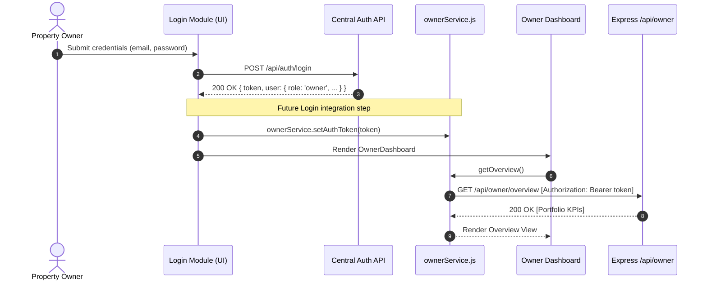

# PropertySE — Owner Module Authentication Integration Contract

**Document Version:** 1.0.0  
**Date:** 2026-11-04  
**Author:** Owner Dashboard Architecture Team  
**Audience:** Login / Identity Team, Backend Integration Engineers, Frontend Core Architects  
**Status:** **PROPOSED INTEGRATION SPECIFICATION (LOGIN MODULE PENDING)**

---

## 1. Executive Context & Purpose

The PropertySE Owner Dashboard module has been developed as an isolated, secure, and self-contained subsystem. In accordance with strict project boundaries, the Owner team has **not** implemented a duplicate authentication system or fabricated mock user sessions.

This contract defines the explicit requirements, data shapes, middleware interfaces, and frontend integration protocols necessary for the future central Login module to integrate seamlessly with the Owner module.

> [!IMPORTANT]
> The central Login module is currently **unavailable**. The Owner API routes (`server/routes/ownerRoutes.js`) remain intentionally **unmounted** in `server/server.js` to preserve the system security boundary. This document specifies the contract the central Login module must satisfy before mounting and production activation can occur.

---

## 2. Authentication Protocol

### 2.1 Transport & Standard
- **Protocol:** Standard Bearer Authentication via the HTTP `Authorization` header.
- **Header Format:**
  ```http
  Authorization: Bearer <JWT_ACCESS_TOKEN>
  ```
- **Token Format:** Signed JSON Web Token (JWT) adhering to RFC 7519.
- **Cryptographic Algorithms:** Asymmetric `RS256` or symmetric `HS256` with high-entropy secrets.

### 2.2 Security Mandates
1. **Server-Side Validation Only:** The backend must independently verify token signature, expiration (`exp`), issuer (`iss`), and audience (`aud`) on every protected request. Client-side claims are never trusted for authorization.
2. **No Hardcoded Tokens:** No development, test, or fallback tokens may be embedded in source code or committed to repositories.
3. **Fail-Closed Default:** Any request lacking a valid `Authorization: Bearer <token>` header must immediately receive `401 Unauthorized` before reaching business logic or database queries.
4. **No Auth Bypass:** Query parameter tokens (`?token=...`), custom unvalidated headers, or mock session cookies are strictly prohibited.

---

## 3. User Identity Contract (`req.user`)

The central authentication middleware must verify the JWT and attach a normalized `user` object to the Express request (`req.user`).

### 3.1 Required Schema

```typescript
interface AuthenticatedUser {
  /** Unique central identifier for the user (UUID or stable provider subject) */
  id: string;

  /** Primary verified email address of the authenticated user */
  email: string;

  /** Primary system role determining high-level access */
  role: 'owner' | 'manager' | 'admin' | 'tenant' | 'worker';

  /** Company / workspace identifier to which the user belongs */
  company_id: string;

  /** Full display name of the authenticated user */
  name: string;
}
```

### 3.2 Property Descriptions & Validation Rules

| Property | Type | Nullable | Example | Validation Rule |
| :--- | :--- | :--- | :--- | :--- |
| `id` | `string` | No | `"a0eebc99-9c0b-4ef8-bb6d-6bb9bd380a11"` | Non-empty string; must match the identifier stored in database foreign keys (`owner_id`, `created_by`). |
| `email` | `string` | No | `"rajesh.sharma@example.com"` | Valid email format, lowercase normalized. |
| `role` | `string` | No | `"owner"` | Must be one of the recognized PropertySE roles. |
| `company_id` | `string` | No | `"COMP_001"` | Non-empty string identifying the workspace boundary. |
| `name` | `string` | No | `"Rajesh Sharma"` | Sanitized display string (1–120 characters). |

> [!NOTE]
> These fields represent **proposed integration requirements** based on Owner module architectural dependencies, not verified claims about an existing Login implementation.

---

## 4. Role-Based Access Control (RBAC) Matrix

The Owner module exposes two classes of endpoints, each governed by role requirements:

| Endpoint Scope | Allowed Roles | Prohibited Roles (403 Forbidden) | Authorization Rule |
| :--- | :--- | :--- | :--- |
| **Owner Dashboard Endpoints** (`/api/owner/*` excluding `/assignments`) | `owner` | `tenant`, `worker`, `manager`*, `admin`* | Only authenticated users with `role: "owner"` may query owner portfolio data, payout coordinates, rental income, and maintenance summaries. Queries are strictly scoped to `po.owner_id = req.user.id`. |
| **Owner Assignment Management** (`POST /api/owner/assignments`) | `manager`, `admin` | `owner`, `tenant`, `worker` | Only property managers and system administrators may assign an owner to a property or set ownership percentages. |

*\*Note on Managers/Admins:* Property managers who require administrative oversight over an owner's properties must access through manager-specific routes (`/api/properties`, `/api/companies`), not by impersonating the owner on `/api/owner/*`.

---

## 5. Expected Shared Backend Middleware (`server/middleware/auth.js`)

To ensure architectural consistency across PropertySE, the central Login team is expected to create and maintain `server/middleware/auth.js`.

> [!CAUTION]
> The Owner team has **not** created or modified `server/middleware/auth.js`. This section defines the expected interface for the Login developer.

### 5.1 Required Exports
The module must export two Express middleware functions:
1. `authenticateUser`: Validates the Bearer token and populates `req.user`.
2. `requireRole(roles)`: Higher-order middleware verifying `req.user.role`.

### 5.2 Proposed Middleware Implementation Template

```javascript
// server/middleware/auth.js (TO BE IMPLEMENTED BY LOGIN TEAM)
const jwt = require('jsonwebtoken');

const JWT_SECRET = process.env.JWT_SECRET;

function authenticateUser(req, res, next) {
  const authHeader = req.headers.authorization;
  if (!authHeader || !authHeader.startsWith('Bearer ')) {
    return res.status(401).json({
      error: 'Authentication required',
      code: 'UNAUTHORIZED',
      message: 'Missing or malformed Authorization header.',
    });
  }

  const token = authHeader.slice(7).trim();
  if (!token) {
    return res.status(401).json({
      error: 'Authentication required',
      code: 'UNAUTHORIZED',
      message: 'Bearer token string is empty.',
    });
  }

  try {
    const decoded = jwt.verify(token, JWT_SECRET, {
      algorithms: ['HS256', 'RS256'],
    });

    if (!decoded.id || !decoded.role || !decoded.company_id) {
      return res.status(401).json({
        error: 'Invalid token claims',
        code: 'INVALID_CLAIMS',
        message: 'Token payload missing required identity claims.',
      });
    }

    req.user = {
      id: String(decoded.id),
      email: String(decoded.email || ''),
      role: String(decoded.role),
      company_id: String(decoded.company_id),
      name: String(decoded.name || ''),
    };

    next();
  } catch (err) {
    if (err.name === 'TokenExpiredError') {
      return res.status(401).json({
        error: 'Token expired',
        code: 'TOKEN_EXPIRED',
        message: 'Session has expired. Please sign in again.',
      });
    }
    return res.status(401).json({
      error: 'Invalid authentication token',
      code: 'INVALID_TOKEN',
      message: 'Token verification failed.',
    });
  }
}

function requireRole(allowedRoles) {
  const roles = Array.isArray(allowedRoles) ? allowedRoles : [allowedRoles];
  return (req, res, next) => {
    if (!req.user || !req.user.role) {
      return res.status(401).json({
        error: 'Authentication required',
        code: 'UNAUTHORIZED',
      });
    }
    if (!roles.includes(req.user.role)) {
      return res.status(403).json({
        error: 'Access denied',
        code: 'FORBIDDEN',
        message: `Role '${req.user.role}' is not authorized to access this resource.`,
      });
    }
    next();
  };
}

module.exports = { authenticateUser, requireRole };
```

---

## 6. Frontend Token Integration Protocol

The frontend Owner API service (`client/src/services/ownerService.js`) is already instrumented to accept and manage authentication tokens securely.

### 6.1 Handshake Flow



### 6.2 Token Management API in `ownerService.js`

```javascript
import { 
  setAuthToken, 
  getAuthToken, 
  clearAuthToken, 
  setDevelopmentPreview 
} from '../services/ownerService';

// 1. When the user successfully signs in:
setDevelopmentPreview(false); // Disable preview mock mode
setAuthToken(sessionToken);   // Injects token into memory for all future requests

// 2. When inspecting active session state:
const currentToken = getAuthToken();

// 3. When the user signs out:
clearAuthToken();             // Immediately flushes in-memory token
```

### 6.3 In-Memory Storage Security Policy
- **No Insecure Storage:** The token is held in module-level JavaScript closure memory (`let activeAuthToken = null`).
- **No Unencrypted LocalStorage:** Sensitive owner session tokens should not be stored in unencrypted `localStorage` where they are vulnerable to cross-site scripting (XSS).
- **Session Lifecycle:** When the browser tab closes or the application unmounts, the in-memory token is cleanly discarded.

---

## 7. Verification Checklist for the Login Team

Before declaring authentication integration complete, the Login team must verify:

- [ ] `POST /api/auth/login` returns a valid JWT with claims: `id`, `email`, `role`, `company_id`, `name`.
- [ ] Non-owner accounts (`tenant`, `worker`) logging in receive 403 Forbidden if they attempt to navigate to `/api/owner/*`.
- [ ] Requests to `/api/owner/*` without a token return 401 Unauthorized with standardized error JSON.
- [ ] Requests with expired tokens return 401 Token Expired.
- [ ] Tampered tokens (modified payload or corrupted signature) return 401 Invalid Token.
- [ ] Successful owner login properly calls `ownerService.setAuthToken(token)`.
- [ ] Logout flushes `ownerService.clearAuthToken()`.

