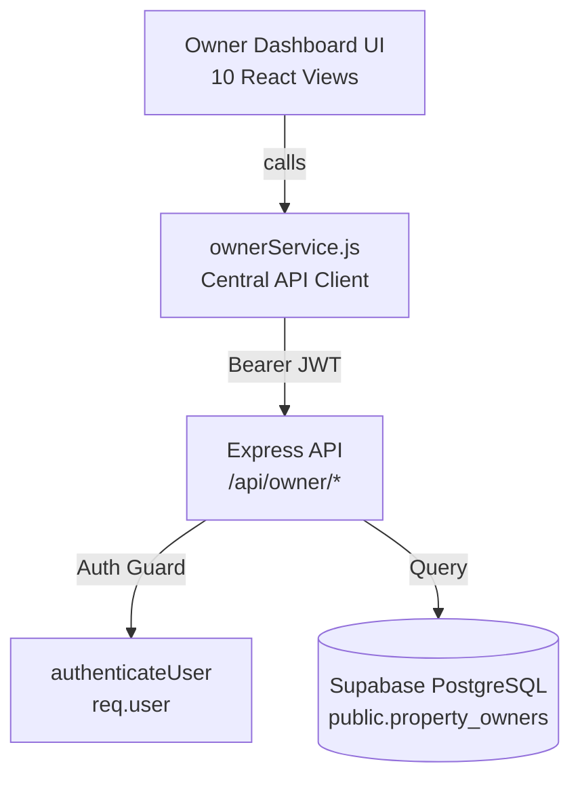

# PropertySE — Owner Dashboard Module Integration Guide

**Document Version:** 1.0.0  
**Date:** 2026-11-04  
**Author:** Owner Dashboard Engineering Team  
**Audience:** Full-Stack Engineers, DevOps, System Integrators  
**Module:** PropertySE Owner Dashboard (`feature-owner`)  
**Status:** **READY FOR TEAM INTEGRATION (AWAITING AUTH & DB DEPLOYMENT)**

---

## 1. Overview & Architecture

The PropertySE Owner Dashboard enables property owners to oversee their real estate assets, monitor tenant occupancy, track maintenance activities, inspect estimated rental disbursements, review financial statements, and manage account payout coordinates.

### Architectural Principles:
1. **Complete Separation of Concerns:** Frontend views never construct raw HTTP queries or fetch requests; all communications pass through `client/src/services/ownerService.js`.
2. **Fail-Closed Security:** In production mode, requests without a valid Bearer token fail immediately on both client and backend boundaries.
3. **Sensitive Data Sanitization:** Payout account numbers and banking details are masked server-side before egress over the network.
4. **Development Preview Isolation:** An in-memory development preview mode is available for local UI evaluation and is strictly deactivated in production builds.



---

## 2. Directory & File Structure

### 2.1 Frontend Files (`client/`)

```
client/src/
├── components/
│   └── owner/
│       ├── OwnerDashboard.jsx         # Root orchestrator: tab navigation, loading states, cache
│       ├── OwnerSidebar.jsx           # Responsive navigation sidebar
│       ├── OwnerTopbar.jsx            # Header with owner profile and notifications pill
│       ├── owner.css                  # Scoped styling for owner dashboard & views
│       └── views/
│           ├── OwnerOverview.jsx      # KPI summary cards, quick alerts, portfolio snapshot
│           ├── OwnerProperties.jsx    # Property cards, occupancy filters, search
│           ├── OwnerPropertyDetails.jsx# Detailed view of a single unit & tenant history
│           ├── OwnerTenants.jsx       # Tenant directory, lease periods, emergency contacts
│           ├── OwnerRentalIncome.jsx  # Rental ledger: potential vs collected income
│           ├── OwnerPayments.jsx      # Payout history & transaction statements (honest empty state)
│           ├── OwnerMaintenance.jsx   # Active & resolved maintenance tickets
│           ├── OwnerReports.jsx       # Financial statements, occupancy reports, print view
│           ├── OwnerNotifications.jsx # Alerts, lease expirations, maintenance updates
│           └── OwnerSettings.jsx      # Owner contact profile and masked payout bank account
└── services/
    └── ownerService.js                # Centralized async API abstraction & mock data engine
```

### 2.2 Backend Files (`server/`)

```
server/
├── routes/
│   └── ownerRoutes.js                 # Owner REST endpoints, role guards, payout masking
└── test/
    ├── owner-routes.test.js           # 15 unit & security tests for owner routes and masking
    └── owner-trigger.test.js          # 6 concurrency and parent row lock validation tests
```

### 2.3 Database Artifacts (`supabase/`)

```
supabase/migrations/
└── 202611030001_create_property_owners.sql  # Migration script for property_owners & audit table
```

---

## 3. Centralized API Service (`ownerService.js`)

All frontend components consume data exclusively through exported functions in `client/src/services/ownerService.js`.

### 3.1 Core Methods

```javascript
import {
  getOverview,
  getProperties,
  getPropertyDetails,
  getTenants,
  getRentalIncome,
  getPayments,
  getMaintenanceRequests,
  getReports,
  getNotifications,
  getSettings,
  updateSettings,
  setAuthToken,
  clearAuthToken,
  setDevelopmentPreview,
  isDevelopmentPreviewEnabled
} from '@/services/ownerService';
```

### 3.2 View Data Loading Pattern
Every view in `client/src/components/owner/views/` adheres to a standard component contract:

```jsx
export function OwnerOverview({ data, loading, error, onRetry }) {
  if (loading) return <div className="owner-loading-state">Loading overview...</div>;
  if (error) return (
    <div className="owner-error-banner">
      <p>{error}</p>
      <button onClick={onRetry}>Retry</button>
    </div>
  );
  // Render content safely using data
}
```

---

## 4. Complete Backend API Endpoint Reference

All endpoints are hosted under `/api/owner` (pending mounting in `server.js`).

| Method | Endpoint | Authorization | Description |
| :--- | :--- | :--- | :--- |
| `GET` | `/api/owner/overview` | `Bearer <token>` (`owner`) | Summary KPIs: total properties, occupancy rate, monthly potential rent, active tickets. |
| `GET` | `/api/owner/properties` | `Bearer <token>` (`owner`) | List of all properties owned by the authenticated owner. |
| `GET` | `/api/owner/properties/:id`| `Bearer <token>` (`owner`) | Single property details, unit specification, tenant details, and active tickets. |
| `GET` | `/api/owner/tenants` | `Bearer <token>` (`owner`) | Directory of all tenants currently residing in owner's properties. |
| `GET` | `/api/owner/financials/income`| `Bearer <token>` (`owner`) | Rental income breakdown: gross potential rent vs billed vs pending. |
| `GET` | `/api/owner/financials/payments`| `Bearer <token>` (`owner`) | Payout settlements history. (Returns honest empty list until billing is integrated). |
| `GET` | `/api/owner/maintenance` | `Bearer <token>` (`owner`) | Maintenance tickets logged against properties owned by the owner. |
| `GET` | `/api/owner/reports` | `Bearer <token>` (`owner`) | Monthly/annual performance summaries and occupancy rate analytics. |
| `GET` | `/api/owner/notifications`| `Bearer <token>` (`owner`) | System notifications, lease expiration alerts, and maintenance updates. |
| `GET` | `/api/owner/settings` | `Bearer <token>` (`owner`) | Owner profile information and sanitized bank payout details. |
| `POST`| `/api/owner/assignments` | `Bearer <token>` (`manager`/`admin`) | Management endpoint to link an owner to a property with an ownership percentage. |

---

## 5. Expected Request & Response Formats

### 5.1 Overview (`GET /api/owner/overview`)
**Response (200 OK):**
```json
{
  "totalProperties": 3,
  "occupiedUnits": 2,
  "vacantUnits": 1,
  "maintenanceUnits": 0,
  "occupancyRate": 67,
  "monthlyExpectedRent": 20667,
  "annualExpectedRent": 248000,
  "activeTenantsCount": 2,
  "openTicketsCount": 1,
  "properties": [
    {
      "id": "e30e168c-1090-4ce0-a24a-5b12da6f55cc",
      "propertyName": "Al Noor Tower",
      "unitNumber": "Flat 101",
      "status": "Occupied",
      "ownershipPercentage": 100.00,
      "ownerShareMonthlyRent": 667,
      "tenant": {
        "fullName": "Chandan Kumar N",
        "phone": "+91 8722743739",
        "email": "chandan@example.com"
      }
    }
  ]
}
```

### 5.2 Settings with Masked Payout (`GET /api/owner/settings`)
**Response (200 OK):**
```json
{
  "id": "a0eebc99-9c0b-4ef8-bb6d-6bb9bd380a11",
  "name": "Rajesh Sharma",
  "email": "rajesh.owner@propertyse.com",
  "phone": "+91 98765 43210",
  "unitsOwned": 3,
  "payoutAccount": {
    "bankName": "HDFC Bank",
    "accountNumberMasked": "•••• •••• •••• 4892",
    "routingMasked": "HDFC•••••••",
    "accountType": "Checking",
    "accountHolderName": "Rajesh Sharma",
    "isConfigured": true
  }
}
```

### 5.3 Management Assignment (`POST /api/owner/assignments`)
**Request Body:**
```json
{
  "propertyId": "e30e168c-1090-4ce0-a24a-5b12da6f55cc",
  "ownerId": "a0eebc99-9c0b-4ef8-bb6d-6bb9bd380a11",
  "ownershipPercentage": 50.00
}
```
**Response (201 Created):**
```json
{
  "message": "Property ownership assigned successfully.",
  "assignment": {
    "id": "9d8e7c6b-5a4f-3e2d-1c0b-a987654321fe",
    "company_id": "COMP_001",
    "property_id": "e30e168c-1090-4ce0-a24a-5b12da6f55cc",
    "owner_id": "a0eebc99-9c0b-4ef8-bb6d-6bb9bd380a11",
    "ownership_percentage": "50.00",
    "is_primary_contact": true,
    "created_by": "manager-1",
    "updated_by": "manager-1"
  }
}
```

---

## 6. Required Environment Variables

The Owner module relies on the following standard PropertySE environment variables (names only):

### Backend (`server/.env`):
- `PORT`: Server listening port (default `5000`).
- `NODE_ENV`: Runtime mode (`development` or `production`).
- `DATABASE_URL`: PostgreSQL connection string.
- `CORS_ORIGINS`: Comma-separated allowed frontend origins.
- `JWT_SECRET`: Secret key for JWT verification (used by future central auth).

### Frontend (`client/.env`):
- `VITE_API_URL`: Base URL for Express backend (default `http://localhost:5000/api`).

---

## 7. Local Development & Testing Instructions

### 7.1 Running the Frontend in Preview Mode
```powershell
cd client
npm.cmd run dev
```
In local development, preview mode is enabled by default in `OwnerDashboard.jsx` allowing full UI navigation and component inspection.

### 7.2 Running Frontend Lint & Build
```powershell
cd client
npm.cmd run lint
npm.cmd run build
```

### 7.3 Running Backend Unit & Security Tests
```powershell
cd server
node --test test/owner-routes.test.js
node --test test/owner-trigger.test.js
npm.cmd test
```

---

## 8. Integration Steps for Main Branch Merging

Once the central Login and Database dependencies are approved, follow these sequential steps to integrate the Owner module:

1. **Step 1: Database Migration:**
   Have the DBA execute `supabase/migrations/202611030001_create_property_owners.sql` on the target database environment.
2. **Step 2: Install Central Auth Middleware:**
   Confirm `server/middleware/auth.js` exports `authenticateUser` and `requireRole`.
3. **Step 3: Mount Owner Routes in `server/server.js`:**
   ```javascript
   // In server/server.js:
   const { authenticateUser } = require("./middleware/auth");
   const ownerRoutes = require("./routes/ownerRoutes");
   
   // Mount protected routes:
   app.use("/api/owner", authenticateUser, ownerRoutes);
   ```
4. **Step 4: Connect Frontend Entry Point in `client/src/App.jsx`:**
   Mount `OwnerDashboard` when `authenticatedUser.role === 'owner'`.
5. **Step 5: Run Regression Tests:**
   Run `npm.cmd test` in `server` and verify all integration endpoints return 200 OK.

---

## 9. Protected Files & Coordination Rules

To avoid merge conflicts and breaking other developers' workflows, **do not modify** the following files without prior team review:

- `server/server.js` (Central route mounting)
- `server/config/db.js` (PostgreSQL connection pool)
- `client/src/App.jsx` (Root application routing)
- `client/src/components/modules/ManagementModules.jsx` (Shared manager views)
- `supabase/migrations/202610270001_propertyse_tenants_maintenance.sql` (Baseline migrations)

