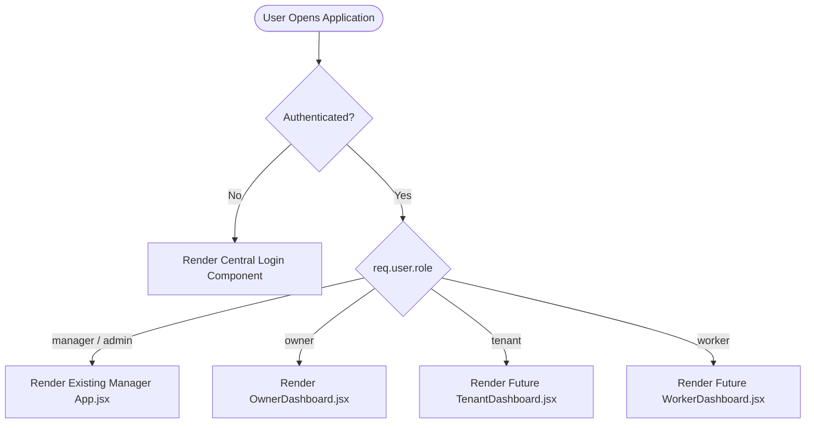
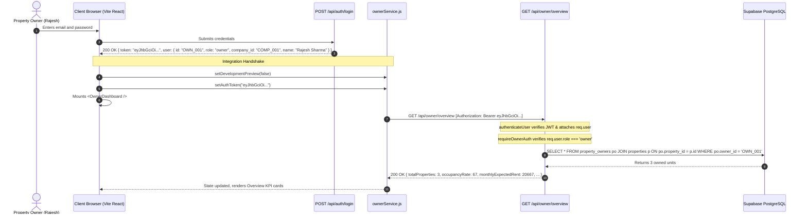
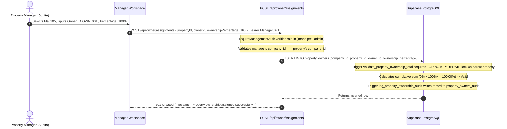

# PropertySE — Step 7: Owner Module Integration Simulation

**Document Version:** 1.0.0  
**Date:** 2026-11-04  
**Author:** Senior Software Integration Architect & Git Integration Engineer  
**Project:** PropertySE (`feature-owner`)  
**Target Integration Branch:** `main`  
**Overall Readiness Classification:** **READY WITH BLOCKERS**

---

## 1. Executive Context & Scope

The PropertySE Owner Dashboard module has reached architectural stabilization (Steps 1–6B). All 10 views, frontend services, backend endpoints, and database migration scripts are complete and tested in isolation.

This document executes an end-to-end **integration simulation**. It models how the Owner module will weave into the central PropertySE application (`client/src/App.jsx`, `server/server.js`, shared navigation, and database layer) once external prerequisites (the central Login module and formal DBA approval) are satisfied.

> [!IMPORTANT]
> This is a **READ-ONLY integration simulation**. No branches have been merged, no shared infrastructure files have been modified, and Owner routes remain safely unmounted in `server/server.js`.

---

## 2. Main Application Architecture & Current State

### 2.1 Current State of `client/src/App.jsx`
The existing `client/src/App.jsx` operates as a single-workspace client tailored exclusively for Property Managers:
- **Navigation Model:** Driven by internal state `const [activeSection, setActiveSection] = useState('overview')`.
- **Company Context:** Manages an active company selector (`companyId`, defaulting to `'COMP_001'`).
- **Mounted Views:** Renders `PortfolioSnapshot` (Overview), `UnitTable` (Properties), and `ManagementModules` (Tenants, Maintenance, Companies).
- **Placeholder Handling:** For unintegrated views, it displays a `<section className="placeholder-page">` with the eyebrow `"PROPERTYSE WORKSPACE"` and badge `"MODULE NOT CONNECTED YET"`.
- **Authentication State:** **Completely absent**. No user login, no session token, and no role identification exist in the active client.

### 2.2 Current State of `server/server.js`
The Express server mounts only manager-facing routes:
- `app.use("/api/properties", propertyRoutes);`
- `app.use("/api/maintenance-tickets", maintenanceTicketRoutes);`
- `app.use("/api/companies", companyRoutes);`
- Health endpoints: `/api/health`, `/api/db-diagnostics`.
- **Authentication Middleware:** **Completely absent**. No JWT verification middleware is mounted.

---

## 3. Proposed Main Application Integration Design

### 3.1 Role-Based Dashboard Routing Model

To allow PropertySE to support multiple user types (Managers, Owners, Tenants, Workers) without monolithic component bloat or style collisions, the application should introduce a top-level **Role Router**:



### 3.2 Simulated Frontend Entry Point Integration (`client/src/App.jsx`)

When the central Login module is delivered, `App.jsx` will wrap or delegate to the authenticated workspace:

```jsx
// SIMULATED INTEGRATION PATTERN FOR App.jsx (NOT YET APPLIED)
import { useState, useEffect } from 'react';
import OwnerDashboard from './components/owner/OwnerDashboard';
import { setAuthToken, clearAuthToken, setDevelopmentPreview } from './services/ownerService';
// Future Login Component:
// import LoginScreen from './components/auth/LoginScreen';

export default function App() {
  const [currentUser, setCurrentUser] = useState(null); // { id, role, token, company_id, name }
  const [authLoading, setAuthLoading] = useState(true);

  useEffect(() => {
    // 1. Inspect existing session (e.g. from secure cookie or memory auth service)
    const session = window.__PROPERTYSE_SESSION__; 
    if (session && session.token) {
      setCurrentUser(session.user);
      if (session.user.role === 'owner') {
        setDevelopmentPreview(false);
        setAuthToken(session.token);
      }
    }
    setAuthLoading(false);
  }, []);

  const handleLoginSuccess = (authPayload) => {
    setCurrentUser(authPayload.user);
    if (authPayload.user.role === 'owner') {
      setDevelopmentPreview(false);
      setAuthToken(authPayload.token);
    }
  };

  const handleLogout = () => {
    clearAuthToken();
    setCurrentUser(null);
  };

  if (authLoading) return <div className="app-splash">Loading PropertySE...</div>;

  // Unauthenticated fallback
  if (!currentUser) {
    // return <LoginScreen onLoginSuccess={handleLoginSuccess} />;
    return <div className="login-placeholder">Please log in to continue.</div>;
  }

  // Role-based workspace rendering
  switch (currentUser.role) {
    case 'owner':
      return <OwnerDashboard onLogout={handleLogout} currentUser={currentUser} />;
    
    case 'manager':
    case 'admin':
      return (
        /* Existing Manager Workspace layout */
        <ManagerWorkspaceLayout currentUser={currentUser} onLogout={handleLogout} />
      );

    case 'tenant':
      return <div className="tenant-portal-placeholder">Tenant Portal Coming Soon</div>;

    case 'worker':
      return <div className="worker-portal-placeholder">Worker Portal Coming Soon</div>;

    default:
      return <div>Unauthorized role: {currentUser.role}</div>;
  }
}
```

### 3.3 Backend Route Mounting & Middleware Pipeline (`server/server.js`)

When `server/middleware/auth.js` is created by the Login team, `server/server.js` will mount the Owner routes under strict JWT protection:

```javascript
// SIMULATED MOUNTING PATTERN IN server/server.js (NOT YET APPLIED)
const { authenticateUser } = require("./middleware/auth");
const ownerRoutes = require("./routes/ownerRoutes");

// 1. Public Authentication Endpoints (Login, Refresh, Logout)
// app.use("/api/auth", authRoutes);

// 2. Manager-facing endpoints (to be secured by authenticateUser + requireRole(['manager', 'admin']))
app.use("/api/properties", propertyRoutes);
app.use("/api/maintenance-tickets", maintenanceTicketRoutes);
app.use("/api/companies", companyRoutes);

// 3. Owner-facing endpoints: Strict Bearer JWT authentication required
// requireOwnerAuth inside ownerRoutes verifies req.user.role === 'owner'
app.use("/api/owner", authenticateUser, ownerRoutes);
```

---

## 4. End-to-End Simulation of Critical User Workflows

### 4.1 Workflow 1: Property Owner Authentication & Dashboard Load



### 4.2 Workflow 2: Property Manager Assigning an Owner to a Unit



### 4.3 Workflow 3: Owner Viewing Maintenance Tickets

1. Owner clicks **Maintenance** tab in `OwnerSidebar`.
2. `OwnerDashboard.jsx` checks memory cache (`sectionCacheRef['maintenance']`). If empty, calls `ownerService.getMaintenanceRequests()`.
3. `ownerService.js` sends `GET /api/owner/maintenance` with Bearer token.
4. Backend extracts `req.user.id`, queries properties owned by this owner, and queries `public.maintenance_tickets` where `property_id = ANY(ownedPropertyIds)`.
5. Tickets return with category (`Plumbing`, `Cleaning`), status (`Open`, `In Progress`, `Resolved`), priority, and tenant name.
6. `OwnerMaintenance.jsx` renders honest ticket timeline with filter pills (`All`, `Open`, `In Progress`, `Resolved`).

### 4.4 Workflow 4: Financial Ledger & Disbursement Honesty

1. Owner navigates to **Rental Income** and **Payments**.
2. **Rental Income:** Backend computes total annual rent of owned units scaled by ownership percentage, divided by 12, labeled strictly as `Estimated Monthly Potential`.
3. **Payments:** Because automated disbursement execution belongs to a future billing module, the backend returns an empty array `[]`.
4. `OwnerPayments.jsx` displays an honest zero-transaction empty state:
   - *"0 Transactions"*
   - *"No payout records or settlement transactions found for your owner profile."*
   - Zero fictional wire transfers or mock payment reference numbers are rendered.

---

## 5. Coexistence and Namespace Isolation

To prevent conflicts when merged alongside Manager, Tenant, and Worker modules:

1. **CSS Isolation:** All styling in `client/src/components/owner/owner.css` is strictly namespaced under `.owner-layout`, `.owner-sidebar`, `.owner-topbar`, `.owner-view`, `.owner-card`, etc. No generic HTML element overrides exist.
2. **State Isolation:** `ownerService.js` maintains private closure state (`activeAuthToken`, `devPreviewEnabled`). It does not pollute `window`, `localStorage`, or shared React contexts.
3. **API Route Isolation:** All owner endpoints are quarantined under `/api/owner/*`. Management endpoints remain on `/api/properties/*` and `/api/companies/*`.
4. **Database Table Isolation:** The ownership mapping table `public.property_owners` and audit table `public.property_owners_audit` do not alter column definitions or foreign key constraints of existing tables.

---

## 6. Simulation Conclusion & Verdict

The integration simulation demonstrates that the Owner module has achieved **architectural decoupling**. It can be integrated into the central PropertySE application in a clean 4-step merge sequence without rewriting existing views or refactoring shared database tables.

However, actual runtime execution in production remains gated by the missing central Login module and pending DBA migration approval.

