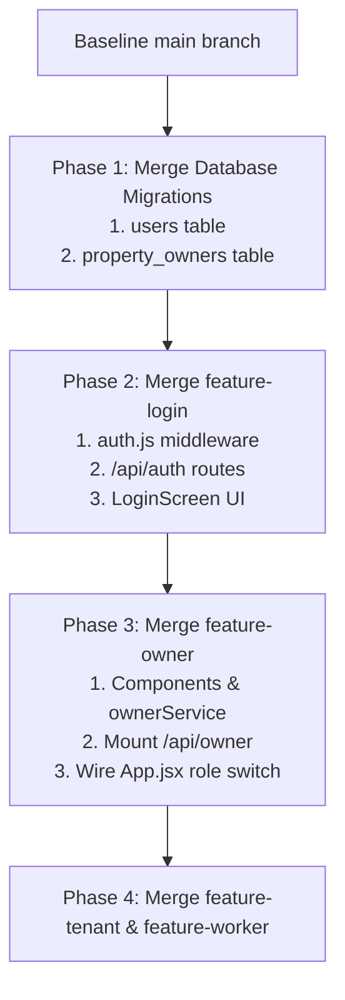

# PropertySE — Step 7: Merge Conflict Prediction & File-by-File Merge Plan

**Document Version:** 1.0.0  
**Date:** 2026-11-04  
**Author:** Senior Software Integration Architect & Git Integration Engineer  
**Source Branch:** `feature-owner`  
**Target Branch:** `main`  
**Git Base Commit:** `ecae518debb4f888546deafb3b4f5f5b4098e01d`  
**Merge Risk Level:** **LOW (CLEAN SEPARATION WITH GATED SHARED ENTRY POINTS)**

---

## 1. Executive Git State Analysis

A read-only inspection of the local Git references was performed across all branches:
- `feature-owner`: `ecae518debb4f888546deafb3b4f5f5b4098e01d`
- `main`: `ecae518debb4f888546deafb3b4f5f5b4098e01d`
- `remotes/origin/main`: `ecae518debb4f888546deafb3b4f5f5b4098e01d`
- `remotes/origin/feature-login`: `ecae518debb4f888546deafb3b4f5f5b4098e01d`
- `remotes/origin/feature-tenant`: `ecae518debb4f888546deafb3b4f5f5b4098e01d`
- `remotes/origin/feature-worker`: `ecae518debb4f888546deafb3b4f5f5b4098e01d`

### Crucial Git Findings:
1. **Identical Base Commit:** All local and remote branches currently point to the exact same commit (`ecae518`). Neither the Login, Tenant, nor Worker branches have merged changes into `main` yet.
2. **Zero Git Working-Tree Modifications:** No tracked files in the `feature-owner` branch have been modified.
3. **Pure Additions:** All Owner module code exists as standalone, uncommitted untracked files. A direct fast-forward or squash merge into `main` today would produce **zero automated Git merge conflicts**.
4. **Prospective Shared File Contention:** When other teams (Login, Tenant, Worker) begin committing changes, contention will concentrate on three shared touchpoints: `server/server.js`, `client/src/App.jsx`, and `supabase/migrations/`.

---

## 2. File-by-File Categorization & Conflict Risk

### 2.1 Category A: Files Exclusive to Owner (Zero Conflict Risk)
These files reside entirely in dedicated namespaces and will never collide with concurrent branch merges:

| File Path | Purpose | Risk Assessment |
| :--- | :--- | :--- |
| `client/src/components/owner/OwnerDashboard.jsx` | Orchestrator component | **None (Clean Addition)** |
| `client/src/components/owner/OwnerSidebar.jsx` | Owner navigation sidebar | **None (Clean Addition)** |
| `client/src/components/owner/OwnerTopbar.jsx` | Owner top header | **None (Clean Addition)** |
| `client/src/components/owner/owner.css` | Scoped Owner styles | **None (Clean Addition)** |
| `client/src/components/owner/views/OwnerOverview.jsx` | Overview KPI cards | **None (Clean Addition)** |
| `client/src/components/owner/views/OwnerProperties.jsx` | Property list | **None (Clean Addition)** |
| `client/src/components/owner/views/OwnerPropertyDetails.jsx` | Property detail view | **None (Clean Addition)** |
| `client/src/components/owner/views/OwnerTenants.jsx` | Tenant directory | **None (Clean Addition)** |
| `client/src/components/owner/views/OwnerRentalIncome.jsx` | Rental income ledger | **None (Clean Addition)** |
| `client/src/components/owner/views/OwnerPayments.jsx` | Payout history | **None (Clean Addition)** |
| `client/src/components/owner/views/OwnerMaintenance.jsx` | Maintenance tickets view | **None (Clean Addition)** |
| `client/src/components/owner/views/OwnerReports.jsx` | Financial reports | **None (Clean Addition)** |
| `client/src/components/owner/views/OwnerNotifications.jsx` | Notifications view | **None (Clean Addition)** |
| `client/src/components/owner/views/OwnerSettings.jsx` | Settings view | **None (Clean Addition)** |
| `client/src/services/ownerService.js` | Central API service | **None (Clean Addition)** |
| `server/routes/ownerRoutes.js` | Backend REST endpoints | **None (Clean Addition)** |
| `server/test/owner-routes.test.js` | Route unit tests | **None (Clean Addition)** |
| `server/test/owner-trigger.test.js` | Trigger concurrency tests | **None (Clean Addition)** |
| `supabase/migrations/202611030001_create_property_owners.sql` | SQL migration script | **Low (Timestamped)** |

---

### 2.2 Category B: Shared Files Requiring Cross-Team Coordination

When the Owner module is merged alongside Login, Tenant, and Worker features, the following shared files will require deliberate integration:

#### 1. `server/server.js` (High Contention Risk)
- **Current State:** Mounts `/api/properties`, `/api/maintenance-tickets`, `/api/companies`.
- **Login Branch Needs:** Will mount `/api/auth` and introduce `authenticateUser` middleware.
- **Owner Branch Needs:** Must mount `app.use("/api/owner", authenticateUser, ownerRoutes);`.
- **Tenant & Worker Branches Need:** May mount `/api/tenants` and `/api/workers`.
- **Conflict Mitigation Strategy:** Establish an agreed-upon mounting order in `server/server.js`:
  ```javascript
  // 1. Core middleware (CORS, body parser)
  // 2. Authentication router (public)
  // 3. Manager routes (secured)
  // 4. Owner routes (secured)
  // 5. Tenant routes (secured)
  // 6. Worker routes (secured)
  // 7. Health & Error handlers
  ```

#### 2. `client/src/App.jsx` (High Contention Risk)
- **Current State:** Contains monolithic Property Manager state and UI.
- **Login Branch Needs:** Will introduce login/logout UI and user session state.
- **Owner Branch Needs:** Needs conditional rendering of `<OwnerDashboard />` when `user.role === 'owner'`.
- **Tenant & Worker Branches Need:** Will introduce `<TenantDashboard />` and `<WorkerDashboard />`.
- **Conflict Mitigation Strategy:** Rather than editing `App.jsx` in competing branches, delegate view selection to an `AppRouter` or role switch:
  ```jsx
  {user.role === 'owner' && <OwnerDashboard />}
  {user.role === 'manager' && <ManagerWorkspace />}
  ```

#### 3. `client/src/components/layouts/navigation.jsx` (Medium Contention Risk)
- **Current State:** Defines `NAV_ITEMS` array for the Manager sidebar.
- **Assessment:** The Owner module has avoided modifying `navigation.jsx` by creating its own dedicated `OwnerSidebar.jsx`. As a result, no Git conflict will occur here.

#### 4. `supabase/migrations/` (Medium Ordering Risk)
- **Current State:** Baseline is `202610270001_propertyse_tenants_maintenance.sql`.
- **Owner Migration:** `202611030001_create_property_owners.sql`.
- **Risk:** If the Login team creates a migration for `public.users` with a later timestamp (e.g. `202611050001_create_users.sql`), but the Owner migration wants to add a foreign key to `users`, the sequence will be broken.
- **Mitigation:** The Owner migration has intentionally omitted the foreign key to `users` for now. When the DBA reviews migrations, the `users` migration must be numbered and executed **prior** to or simultaneously with `property_owners`.

#### 5. `server/package.json` & `server/package-lock.json` (Low Risk)
- **Current State:** Dependencies are `cors`, `dotenv`, `express`, `pg`.
- **Login Branch:** Will likely add `jsonwebtoken`, `bcryptjs`.
- **Owner Branch:** Has added **zero** new npm dependencies. It uses native Node.js and existing packages. No package merge conflict will originate from the Owner module.

---

## 3. Recommended Sequential Merge Plan

To avoid merge chaos and preserve continuous build integrity, the team leads must follow this chronological merge sequence:



### Detailed Phase Actions:

1. **Phase 1: Database Migration Consensus:**
   - Login team defines `public.users` schema.
   - DBA reviews and merges `202611030001_create_property_owners.sql` with foreign key referencing `users(id)`.
   - Run in staging Supabase.

2. **Phase 2: Login Module Landing:**
   - Merge `feature-login` into `main`.
   - Verify `server/middleware/auth.js` exports `authenticateUser` and `requireRole`.
   - Verify `POST /api/auth/login` issues valid JWTs.

3. **Phase 3: Owner Module Landing:**
   - Checkout a fresh merge branch from updated `main`.
   - Add all Owner-specific files (`client/src/components/owner/`, `ownerService.js`, `ownerRoutes.js`, test files).
   - Mount `/api/owner` in `server/server.js` behind `authenticateUser`.
   - Add the `<OwnerDashboard />` role branch in `client/src/App.jsx`.
   - Run `npm.cmd test` and `npm.cmd run build`.
   - Merge into `main`.

4. **Phase 4: Downstream Modules (Tenant & Worker):**
   - Tenant and Worker branches rebase on top of the stabilized `main`.

---

## 4. Conflict Verification Matrix

| Candidate File | Merge Impact | Conflict Likelihood | Resolution Strategy |
| :--- | :--- | :--- | :--- |
| `server/server.js` | Route mounting | High (if parallel merges) | Merge Login first, then Owner. Add routes in designated blocks. |
| `client/src/App.jsx` | Top-level view rendering | High (if parallel merges) | Adopt role switcher; keep Owner workspace self-contained. |
| `client/src/components/owner/*` | New directory | Zero | Automatic fast-forward addition. |
| `client/src/services/ownerService.js`| New service file | Zero | Automatic fast-forward addition. |
| `server/routes/ownerRoutes.js` | New route file | Zero | Automatic fast-forward addition. |
| `supabase/migrations/*` | Database scripts | Low | Verify chronological timestamp ordering with DBA. |

