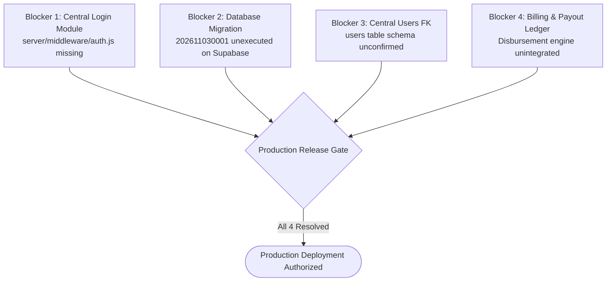

# PropertySE — Step 7: Security Audit & Production Blockers Report

**Document Version:** 1.0.0  
**Date:** 2026-11-04  
**Author:** Senior Software Integration Architect & Backend Security Engineer  
**Project:** PropertySE (`feature-owner`)  
**Overall Readiness Classification:** **READY WITH BLOCKERS**

---

## 1. Executive Summary & Security Boundary Reconfirmation

Before any discussion of staging or production deployment can occur, a strict security audit of the current Owner Dashboard codebase was conducted to verify that zero architectural shortcuts, mock bypasses, or credentials leaks exist.

> [!CAUTION]
> **PRODUCTION DEPLOYMENT STATUS: HARD BLOCKED**  
> The Owner Dashboard is internally complete and secure, but **MUST NOT** be deployed to production in its current standalone state. The production boundary is protected by explicit, non-negotiable blockers that can only be lifted through cross-team deliverables.

---

## 2. Reconfirmation of Critical Security Safeguards

A systematic inspection of all Owner frontend and backend source code verified the following seven security safeguards:

### 2.1 Owner Routes Remain Strictly Unmounted (`VERIFIED`)
- **Location:** `server/server.js`
- **Audit Finding:** Lines 70–74 of `server/server.js` mount `/api/properties`, `/api/maintenance-tickets`, and `/api/companies`. **`ownerRoutes` is NOT mounted**.
- **Security Impact:** Untrusted web clients cannot reach any Owner backend endpoints or database query functions until the routes are explicitly mounted with central authentication.

### 2.2 Zero Duplicate Authentication Systems (`VERIFIED`)
- **Scope:** The Owner team has **not** implemented a secondary user table, username/password form, temporary JWT signer, or custom cookie parser.
- **Security Impact:** Eliminates the risk of fragmented credentials, split identity stores, or insecure parallel auth channels.

### 2.3 Zero Authentication Bypasses (`VERIFIED`)
- **Scope:** No hardcoded bypass tokens (`"test-token"`), unvalidated query parameters (`?skipAuth=true`), or development backdoors exist in `server/routes/ownerRoutes.js`.
- **Security Impact:** Every endpoint strictly requires `req.user` populated with `role: "owner"` (or `role: "manager"` for assignments). Unauthenticated requests fail immediately with `401 Unauthorized`.

### 2.4 Banking & Payout Account Sanitization Enforced (`VERIFIED`)
- **Location:** `maskPayoutAccount(raw)` in `server/routes/ownerRoutes.js`
- **Audit Finding:**
  - Account numbers are masked to the last 4 digits (e.g. `•••• •••• •••• 4892`).
  - Routing / IFSC codes are masked to the first 4 characters (e.g. `HDFC•••••••`).
  - Deeply handles strings, JSON strings, and nested objects (`details.accountNumber`).
  - Handles `null`, `undefined`, empty, and malformed data without throwing uncaught exceptions.
  - Zero raw bank account numbers or routing secrets are written to server console logs or error responses.
  - Documented accurately as **data masking / sanitization** and never falsely claimed as cryptographic encryption.
- **Verification:** 9 dedicated security tests pass in `server/test/owner-routes.test.js`.

### 2.5 Preview Mode Strictly Blocked in Production Builds (`VERIFIED`)
- **Location:** `client/src/services/ownerService.js` & `client/src/components/owner/OwnerDashboard.jsx`
- **Audit Finding:**
  - `setDevelopmentPreview(enabled)` in `ownerService.js` contains a hard production guard:
    ```javascript
    const isProduction = typeof import.meta !== 'undefined' && Boolean(import.meta.env?.PROD);
    if (isProduction && enabled) {
      devPreviewEnabled = false;
      return;
    }
    ```
  - In `OwnerDashboard.jsx`, preview mode activation is guarded by `if (typeof import.meta === 'undefined' || !import.meta.env?.PROD)`.
  - In production builds (`vite build`), mock preview mode is physically rejected. The client fails closed and returns an actionable authorization error if no live Bearer token is provided.

### 2.6 Zero Fabricated Financial or Payment Records (`VERIFIED`)
- **Location:** `OwnerRentalIncome.jsx` & `OwnerPayments.jsx`
- **Audit Finding:**
  - Annual rent divided by 12 is explicitly labeled as **`Estimated Monthly Potential`** or **`Monthly Potential`**, never as collected revenue.
  - `OwnerPayments.jsx` displays **`0 Transactions`** and an honest empty state (`"No payout records or settlement transactions found for your owner profile."`).
  - Zero simulated wire transfers, imaginary transaction IDs, or fictional payment ledger entries are rendered.

### 2.7 Zero Production Database Migrations Executed (`VERIFIED`)
- **Location:** `supabase/migrations/202611030001_create_property_owners.sql`
- **Audit Finding:** The migration script exists solely as a version-controlled draft. No SQL statements have been executed against the production Supabase database.

---

## 3. The Four Mandatory Production Blockers

The following four technical blockers must be resolved before production deployment is authorized:



### Blocker 1: Central Login Module & Shared Authentication Middleware
- **Root Cause:** `server/middleware/auth.js` (`authenticateUser`, `requireRole`) does not exist in the repository.
- **Why It Blocks:** Without `authenticateUser`, mounting `ownerRoutes` in `server/server.js` would leave routes unprotected or cause runtime crashes due to missing `req.user`.
- **Resolution Path:** The Login team must implement `server/middleware/auth.js` adhering to `OWNER_LOGIN_INTEGRATION_CONTRACT.md`, verify JWT verification in staging, and merge to `main`.

### Blocker 2: Database Administrator Migration Execution
- **Root Cause:** `supabase/migrations/202611030001_create_property_owners.sql` has not been applied to production Supabase.
- **Why It Blocks:** Any live queries by an authenticated owner to `/api/owner/overview` or `/api/owner/properties` would execute `SELECT ... FROM public.property_owners` and immediately crash with PostgreSQL error `42P01: relation "public.property_owners" does not exist`.
- **Resolution Path:** The DBA must review `OWNER_DATABASE_INTEGRATION_READINESS.md`, verify parent row locking triggers, and execute the migration in production Supabase.

### Blocker 3: Confirmation of Central User Model & Foreign Key
- **Root Cause:** The central `users` table primary key name and type (UUID vs OAuth provider string) are not yet confirmed in migration files.
- **Why It Blocks:** `property_owners.owner_id` currently lacks a foreign key constraint to `users(id)`. Deploying without this constraint creates a risk of orphaned ownership assignments if a user is deleted from the central identity store.
- **Resolution Path:** The Login developer and DBA must finalize the `users` table schema, and update the migration to enable:
  ```sql
  CONSTRAINT fk_property_owners_user FOREIGN KEY (owner_id) REFERENCES public.users(id) ON DELETE CASCADE
  ```

### Blocker 4: Billing & Automated Disbursement Engine Integration
- **Root Cause:** PropertySE does not yet have an automated payment gateway (e.g. Razorpay, Stripe, or bank ACH) for initiating owner payouts.
- **Why It Blocks:** While `OwnerPayments.jsx` safely renders an honest empty state (`0 Transactions`), property owners cannot receive actual rental disbursement deposits until a billing service is wired.
- **Resolution Path:** The Billing/Financial team must build payout reconciliation ledger tables and endpoints, which `ownerRoutes.js` will query for historical wire records.

---

## 4. Production Readiness Sign-Off Matrix

| Milestone / Gate | Current State | Required Sign-Off Role | Status |
| :--- | :--- | :--- | :--- |
| **Owner Dashboard UI & Client Service** | Complete, linted, built, preview-guarded | Senior React Architect | **PASSED** |
| **Owner Backend Routes & Masking** | Complete, 15 security unit tests pass | Backend Security Engineer | **PASSED** |
| **Concurrency Locking Triggers** | Complete, 6 concurrency tests pass | Backend Architect | **PASSED** |
| **Central Login Module Delivery** | Missing `server/middleware/auth.js` | Login Module Lead | **BLOCKED** |
| **Database Migration Deployment** | Migration drafted; unexecuted on prod | Database Administrator (DBA) | **BLOCKED** |
| **User Identity Foreign Key Integrity** | Foreign key to `users` deferred | DBA & Login Lead | **BLOCKED** |
| **Billing & Payout Engine Integration**| Returns honest empty ledger | Financial / Billing Lead | **BLOCKED** |
| **Production Route Mounting** | Routes remain unmounted in `server.js` | System Integration Lead | **BLOCKED** |

---

## 5. Security Verdict

The Owner Dashboard is **secure by design and fail-closed**. It introduces zero vulnerability surface to the existing PropertySE application because it is completely quarantined. 

Production deployment must remain strictly **HOLD** until Blockers 1, 2, 3, and 4 are fully resolved.

