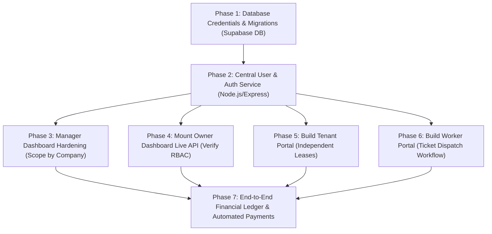

# PropertySE — Cross-Dashboard Integration Architecture & Execution Plan

**Project:** PropertySE (`propertyse-v1`)  
**Document Classification:** Architectural Integration Blueprint  
**Target Roles:** Manager, Owner, Tenant, Worker  
**Active Branch:** `feature-owner`  
**Git Root:** `c:\Users\Asus\OneDrive\Desktop\works\Pentabytelabs\Propertyse-V1-main\Propertyse-V1-main`  
**Publication Date:** November 4, 2026  

---

## 1. Executive Vision & Architecture Overview

PropertySE is transitioning from isolated frontend prototypes into a unified, secure, enterprise-grade multi-role Property Management System (PMS). The system serves four distinct user roles through a centralized Express API and a single PostgreSQL database hosted on Supabase:

```
                                  +---------------------------------------+
                                  |     Central Authentication Service    |
                                  |   (JWT / HttpOnly Cookie / RBAC)      |
                                  +---------------------------------------+
                                                      |
                  +-------------------+---------------+-------------------+-------------------+
                  |                   |                                   |                   |
                  v                   v                                   v                   v
          +---------------+   +---------------+                   +---------------+   +---------------+
          |    MANAGER    |   |     OWNER     |                   |    TENANT     |   |    WORKER     |
          |   DASHBOARD   |   |   DASHBOARD   |                   |    PORTAL     |   |    PORTAL     |
          +---------------+   +---------------+                   +---------------+   +---------------+
                  |                   |                                   |                   |
                  |                   |                                   |                   |
                  +-------------------+---------------+-------------------+-------------------+
                                                      |
                                                      v
                                  +---------------------------------------+
                                  |     Express 5.x Central REST API      |
                                  |    (Middlewares, RBAC, Validation)    |
                                  +---------------------------------------+
                                                      |
                                                      v
                                  +---------------------------------------+
                                  |    Supabase PostgreSQL (Port 5432)   |
                                  |  (Row Locks, Triggers, RLS, Cascades) |
                                  +---------------------------------------+
```

### Current Architectural State
- **Manager Dashboard:** Live in `client/src/App.jsx`. Directly interacts with `/api/properties`, `/api/companies`, and `/api/maintenance-tickets` with **no authentication or authorization**.
- **Owner Dashboard:** Fully built with 10 comprehensive views (`client/src/components/owner/`) and a dedicated service layer (`ownerService.js`). Currently running safely in offline development preview mode. The backend routes (`ownerRoutes.js`) are fully hardened with role checks and row-level locks, but are **unmounted in `server/server.js`** pending central auth.
- **Tenant Portal:** **Missing as an independent application**. Only basic lease editing exists within the Manager's unit table.
- **Worker Portal:** **Completely missing**. No technician views, queues, or update workflows exist.

---

## 2. Shared Data Entities & Cross-Role Interaction Matrix

The table below outlines how the core data entities flow across all four roles:

| Entity | Manager Role | Owner Role | Tenant Role | Worker Role |
| :--- | :--- | :--- | :--- | :--- |
| **Properties / Units** | **Full CRUD & Management:** Creates units, assigns leases, sets market rent, triggers maintenance status. | **Read-Only (Scoped):** Views owned units, unit specifications, occupancy percentage, and lease expiry dates. | **Read-Only (Assigned):** Views their rented unit details, amenities, and house rules. | **Read-Only (Assigned):** Views unit location, access instructions, and entry permissions for repairs. |
| **Maintenance Tickets** | **Full Oversight & Dispatch:** Receives tickets, assigns priority, dispatches to workers, reviews costs. | **Read-Only (Financial Impact):** Tracks repair progress, cost deductions, and historical impact on owned units. | **Create & Track:** Submits tickets with photos, tracks repair status, confirms issue resolution. | **Accept & Resolve:** Claims tickets, updates status (`In Progress`, `Resolved`), adds work notes and labor hours. |
| **Leases & Occupancy** | **Create & Terminate:** Executes leases, adjusts rent, processes move-ins/move-outs. | **Read-Only:** Monitors lease duration, tenant names, and renewal timelines. | **View & Acknowledge:** Views signed lease agreement, expiry dates, and renewal terms. | **No Access.** |
| **Payments & Rent** | **Full Ledger Control:** Monitors incoming tenant payments, overdue accounts, management fee deductions. | **Disbursement Ledger:** Views net monthly rental income, pro-rata distributions, and masked payout account. | **Pay & Ledger:** Pays monthly rent, downloads receipts, views payment history and late fees. | **Invoicing:** Submits parts and labor expense invoices for approved tickets. |
| **Ownership Contracts** | **Assign & Audit:** Assigns owners to units, enforces <= 100% total ownership share. | **View Only:** Views owned percentage share, co-owner share summary, and legal contracts. | **No Access.** | **No Access.** |

---

## 3. Data Isolation & Security Boundary Rules

To prevent unauthorized cross-tenant data leakage and Privilege Escalation, every request passing through the Express API must strictly conform to these isolation rules:

```
========================================================================================
                               DATA ISOLATION PRINCIPLES
========================================================================================

1. MANAGER ISOLATION (Company Scope):
   - Every Manager query MUST be filtered by `company_id = req.user.company_id`.
   - Never allow a manager to supply an arbitrary `companyId` in the query string or body.
   - Managers cannot inspect or alter data belonging to competing management companies.

2. OWNER ISOLATION (Ownership Link Scope):
   - Every Owner query MUST join `public.property_owners po ON po.property_id = p.id`.
   - Filter strictly by `po.owner_id = req.user.id AND po.is_active = TRUE`.
   - Owners must NEVER see units they do not own, or financial information of other co-owners.
   - Sensitive bank payout accounts MUST be masked over the wire (`maskPayoutAccount`).

3. TENANT ISOLATION (Lease Assignment Scope):
   - Every Tenant query MUST join `public.leases l ON l.unit_id = p.id`.
   - Filter strictly by `l.tenant_id = req.user.id AND l.status = 'Active'`.
   - Tenants can ONLY view tickets and transactions associated with their own lease.

4. WORKER ISOLATION (Dispatch & Queue Scope):
   - Filter tickets by `assigned_worker_id = req.user.id OR (status = 'Open' AND company_id = req.user.company_id)`.
   - Workers cannot view property ownership details, tenant financial records, or owner payouts.
========================================================================================
```

---

## 4. Central Authentication & Session Architecture

The central authentication layer must be built immediately to unblock all four dashboards.

### 4.1 Target Identity Schema (`public.users`)
```sql
CREATE TYPE user_role AS ENUM ('manager', 'owner', 'tenant', 'worker', 'admin');

CREATE TABLE public.users (
  id UUID PRIMARY KEY DEFAULT gen_random_uuid(),
  email VARCHAR(255) UNIQUE NOT NULL,
  password_hash VARCHAR(255) NOT NULL,
  first_name VARCHAR(100) NOT NULL,
  last_name VARCHAR(100) NOT NULL,
  phone VARCHAR(50),
  role user_role NOT NULL,
  company_id VARCHAR(64) REFERENCES public.companies(id) ON DELETE SET NULL,
  avatar_url TEXT,
  is_active BOOLEAN NOT NULL DEFAULT TRUE,
  created_at TIMESTAMPTZ NOT NULL DEFAULT NOW(),
  updated_at TIMESTAMPTZ NOT NULL DEFAULT NOW()
);

CREATE INDEX idx_users_email ON public.users(email);
CREATE INDEX idx_users_company_role ON public.users(company_id, role);
```

### 4.2 Central Auth Middleware (`server/middleware/auth.js`)
```javascript
const jwt = require("jsonwebtoken");

const JWT_SECRET = process.env.JWT_SECRET;
if (!JWT_SECRET && process.env.NODE_ENV === "production") {
  throw new Error("FATAL: JWT_SECRET environment variable is missing.");
}

/**
 * Validates JWT from Authorization: Bearer <token> or signed HttpOnly cookie.
 * Attaches decoded user payload to req.user.
 */
function authenticateToken(req, res, next) {
  const authHeader = req.headers["authorization"];
  const token = authHeader && authHeader.startsWith("Bearer ")
    ? authHeader.slice(7).trim()
    : req.cookies?.token;

  if (!token) {
    return res.status(401).json({
      error: "Authentication required",
      code: "UNAUTHORIZED",
      message: "Please sign in to access this resource."
    });
  }

  try {
    const decoded = jwt.verify(token, JWT_SECRET || "dev-insecure-jwt-secret");
    req.user = decoded; // { id, email, role, companyId }
    next();
  } catch (err) {
    return res.status(403).json({
      error: "Invalid or expired session token",
      code: "FORBIDDEN",
      message: "Your session has expired. Please sign in again."
    });
  }
}

/**
 * Role-Based Access Control (RBAC) guard.
 * @param {string[]} allowedRoles - Array of authorized roles
 */
function requireRoles(...allowedRoles) {
  return (req, res, next) => {
    if (!req.user || !req.user.role) {
      return res.status(401).json({ error: "Authentication required", code: "UNAUTHORIZED" });
    }

    if (!allowedRoles.includes(req.user.role)) {
      return res.status(403).json({
        error: "Insufficient permissions",
        code: "FORBIDDEN",
        message: `Access denied. Requires one of roles: [${allowedRoles.join(", ")}].`
      });
    }

    next();
  };
}

module.exports = { authenticateToken, requireRoles };
```

---

## 5. Frontend Navigation & Role-Based Routing Architecture

The React frontend currently renders `App.jsx` directly as the Manager Dashboard. A unified application shell must be introduced:

```
                                  +---------------------------------------+
                                  |              index.html               |
                                  +---------------------------------------+
                                                      |
                                                      v
                                  +---------------------------------------+
                                  |              main.jsx                 |
                                  |   (AuthProvider, Theme, ToastContext) |
                                  +---------------------------------------+
                                                      |
                                                      v
                                  +---------------------------------------+
                                  |              Router                   |
                                  +---------------------------------------+
                                      |               |               |
             +------------------------+               |               +-----------------------+
             |                                        |                                       |
             v                                        v                                       v
    +-----------------+                     +-------------------+                   +------------------+
    |   /login Route  |                     |  Protected Role   |                   |  Development     |
    |  (Public Form)  |                     |  Routes (4 Dash)  |                   |  Switcher Banner |
    +-----------------+                     +-------------------+                   +------------------+
                                                      |
                          +-------------------+-------+-------+-------------------+
                          |                   |               |                   |
                          v                   v               v                   v
                   +-------------+     +-------------+ +-------------+     +-------------+
                   |  /manager/* |     |   /owner/*  | |  /tenant/*  |     |  /worker/*  |
                   | (Manager App|     | (Owner Portal| (Tenant Portal|    | (Worker PWA |
                   +-------------+     +-------------+ +-------------+     +-------------+
```

### 5.1 Route Wrapper Implementation (`client/src/components/common/ProtectedRoute.jsx`)
```jsx
import React from 'react';
import { useAuth } from '../../context/AuthContext';

export default function ProtectedRoute({ allowedRoles, children }) {
  const { user, loading } = useAuth();

  if (loading) {
    return <div className="loading-spinner">Loading session...</div>;
  }

  if (!user) {
    // Redirect to login preserving destination
    window.location.hash = '#login';
    return null;
  }

  if (!allowedRoles.includes(user.role)) {
    return (
      <div className="unauthorized-container">
        <h2>Access Denied</h2>
        <p>Your current account ({user.role}) does not have permission to access this portal.</p>
        <button onClick={() => window.location.hash = `#${user.role}`}>
          Go to My Dashboard
        </button>
      </div>
    );
  }

  return children;
}
```

---

## 6. Phased Implementation Sequence

The cross-dashboard integration must proceed in an orderly, multi-step sequence to avoid race conditions and regressions:



### Phase 1 — Database Foundation & Credential Synchronization
- **Responsible:** DevOps / Database Administrator.
- **Actions:**
  1. Synchronize the PostgreSQL password in `server/.env` with Supabase project `oyjmdtngezoqvgkqfhay`.
  2. Execute `001_initial_schema.sql` to verify base tables (`companies`, `properties`, `maintenance_tickets`).
  3. Execute `002_owner_dashboard_schema.sql` to create `property_owners` and `property_owners_audit` with concurrency row-locking triggers.
  4. Create `003_auth_and_roles_schema.sql` to introduce `public.users` and enum `user_role`.

### Phase 2 — Central User & Authentication Infrastructure
- **Responsible:** Backend Team (Lead) + Login Sub-Team.
- **Actions:**
  1. Create `server/routes/authRoutes.js` (`/login`, `/register`, `/me`, `/logout`).
  2. Implement bcrypt password hashing and signed JWT issuance.
  3. Create `server/middleware/auth.js` (`authenticateToken`, `requireRoles`).
  4. Create `client/src/context/AuthContext.jsx` with token persistence and session hydration.

### Phase 3 — Manager Dashboard Security Hardening
- **Responsible:** Frontend Manager Team + Backend Team.
- **Actions:**
  1. Wrap `propertyRoutes.js`, `companyRoutes.js`, and `maintenanceTicketRoutes.js` with `authenticateToken` and `requireRoles('manager', 'admin')`.
  2. Replace unverified query param `companyId` with `req.user.companyId`.
  3. Update `client/src/App.jsx` to pass JWT headers in all `fetch()` calls.

### Phase 4 — Owner Dashboard Live API Mounting
- **Responsible:** Owner Dashboard Lead (Current Branch Author).
- **Actions:**
  1. Mount `app.use('/api/owner', authenticateToken, ownerRoutes)` in `server/server.js`.
  2. Toggle `client/src/services/ownerService.js` from `FORCE_DEV_PREVIEW = true` to live API fetching with graceful fallback.
  3. Verify all 10 Owner views against live Supabase PostgreSQL data.

### Phase 5 — Tenant Portal Development
- **Responsible:** Tenant Team.
- **Actions:**
  1. Decouple tenant records from `properties` into a dedicated `public.tenants` and `public.leases` table.
  2. Build `client/src/components/tenant/` portal with:
     - My Lease Agreement view
     - Pay Rent & Payment History view
     - Submit Maintenance Ticket view (with photo upload)
  3. Connect to backend `routes/tenantRoutes.js`.

### Phase 6 — Worker / Technician Portal Development
- **Responsible:** Worker Team.
- **Actions:**
  1. Create `client/src/components/worker/` mobile-first responsive PWA.
  2. Implement Worker Dispatch Queue:
     - Claim open tickets from pool
     - Update ticket status (`In Progress`, `Awaiting Parts`, `Resolved`)
     - Log labor hours and replacement parts
  3. Mount `routes/workerRoutes.js`.

### Phase 7 — Financial Ledger & Automated Payment Integration
- **Responsible:** Full-Stack Integration Lead.
- **Actions:**
  1. Integrate Stripe/Razorpay webhook listeners for automatic rent settlement.
  2. When a tenant pays rent:
     - Update property balance.
     - Calculate manager fee percentage.
     - Automatically credit pro-rata shares to owner payout accounts.
     - Log full transaction history into `public.financial_transactions`.

---

## 7. Immediate Handover Directives & Team Assignments

| Team Member / Role | Immediate Responsibility | Blocker / Dependency |
| :--- | :--- | :--- |
| **DevOps / DBA** | Update `server/.env` with valid Supabase password and apply migrations `001`, `002`, `003`. | Supabase Dashboard access required. |
| **Auth Team Lead** | Implement `public.users` table, `server/routes/authRoutes.js`, and `server/middleware/auth.js`. | Dependent on Phase 1 DB synchronization. |
| **Owner Team (Current)** | Maintain offline development preview in `feature-owner`; prepare `ownerRoutes.js` for mounting once auth middleware is ready. | Blocked on Phase 2 Auth Middleware. |
| **Manager Team** | Update `client/src/App.jsx` to attach JWT Bearer tokens to all API calls; eliminate hardcoded `COMP_001`. | Blocked on Phase 2 Auth Middleware. |
| **Tenant Team** | Build standalone Tenant Portal components and design `public.leases` separation. | Blocked on Phase 2 Auth Middleware. |
| **Worker Team** | Build Technician dispatch interface and maintenance claim endpoints. | Blocked on Phase 2 Auth Middleware. |

