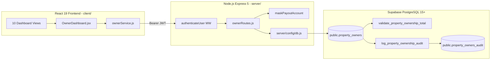

# PropertySE — Owner Dashboard Team Integration Package

**Package Version:** 1.0.0-rc1  
**Date:** 2026-11-04  
**Author:** Senior Full-Stack Architect & Release Lead  
**Target Audience:** Core Development Team, Team Leads, DevOps, Database Administrators  
**Working Branch:** `feature-owner`  
**Classification:** **RELEASE CANDIDATE READY WITH BLOCKERS**

---

## A. Owner Module Overview

The PropertySE Owner Dashboard provides real estate asset owners with a single, dedicated portal to monitor their property portfolio, track occupancy, inspect financial returns, review maintenance operations, and manage sensitive payout banking accounts.

### The Ten Functional Views:
1. **Overview (`OwnerOverview.jsx`):** High-level KPI summary cards displaying Total Properties Owned, Portfolio Occupancy Rate (%), Estimated Monthly Potential Rent, and Active Maintenance Tickets. Features quick alerts and a portfolio preview.
2. **Properties (`OwnerProperties.jsx`):** Filterable portfolio catalog displaying unit cards with occupancy status (`Occupied`, `Vacant`, `Maintenance`), building number, monthly rent share, and search filtering.
3. **Property Details (`OwnerPropertyDetails.jsx`):** Deep drilldown view for a selected unit showing physical specs, tenant lease duration, rental amounts, and historical maintenance tickets for that unit.
4. **Tenants (`OwnerTenants.jsx`):** Tenant directory listing all occupants residing across the owner's units, their contact information (phone, email), and lease term periods.
5. **Rental Income (`OwnerRentalIncome.jsx`):** Honest financial breakdown showing gross potential revenue vs billed rent vs pending collections, calculated transparently by unit.
6. **Payments (`OwnerPayments.jsx`):** Payout disbursement history. Transparently displays an honest empty state (`0 Transactions`) until a live billing ledger is integrated.
7. **Maintenance (`OwnerMaintenance.jsx`):** Comprehensive log of work orders across owned units, filterable by status (`All`, `Open`, `In Progress`, `Resolved`), with category and urgency tags.
8. **Reports (`OwnerReports.jsx`):** Analytical summaries, occupancy statements, annual rent projections, and a dedicated print layout for physical recordkeeping.
9. **Notifications (`OwnerNotifications.jsx`):** Activity stream showing lease expiration notices, maintenance work order updates, and vacancy announcements.
10. **Settings (`OwnerSettings.jsx`):** Owner profile management and bank account configuration, rendering masked account and routing coordinates.

---

## B. System Architecture & Responsibilities



### Architectural Division of Responsibilities:
- **Frontend Views (`components/owner/views/`):** Pure presentation components adhering to normalized props (`data`, `loading`, `error`, `onRetry`). Views never invoke `fetch` directly.
- **Orchestrator (`OwnerDashboard.jsx`):** Manages section switching, memory caching (`sectionCacheRef`), race-condition prevention (`activeRequestIdRef`), and responsive layout.
- **API Service Layer (`ownerService.js`):** Encapsulates HTTP communications, Bearer token storage in memory closure, error normalization, and preview mode isolation.
- **Backend Router (`ownerRoutes.js`):** Enforces role authorization (`requireOwnerAuth`, `requireManagementAuth`), extracts identity from `req.user.id`, isolates tenant companies, and sanitizes banking coordinates.
- **Database Layer (`202611030001_create_property_owners.sql`):** Enforces data integrity via composite foreign keys `(property_id, company_id)`, row-level locking triggers (`FOR NO KEY UPDATE`), and an append-only audit trail.

---

## C. Login Integration Requirements

The Owner module relies on the central Login module for authentication. It does **not** implement duplicate authentication.

### 1. HTTP Transport Protocol
All requests to `/api/owner/*` must include the Bearer token in the standard HTTP header:
```http
Authorization: Bearer <JWT_ACCESS_TOKEN>
```

### 2. Required `req.user` Schema
The future `server/middleware/auth.js` (`authenticateUser`) must verify the JWT and populate `req.user`:
```typescript
interface AuthenticatedUser {
  id: string;          // Central user ID matching owner_id
  email: string;       // Verified user email
  role: 'owner' | 'manager' | 'admin' | 'tenant' | 'worker';
  company_id: string;  // Multi-tenant workspace identifier
  name: string;        // Display name
}
```

### 3. Role Authorization Matrix
- `/api/owner/*` (excluding `/assignments`): Restricted to `req.user.role === 'owner'`.
- `/api/owner/assignments`: Restricted to `req.user.role in ['manager', 'admin']`.

### 4. Frontend Token Injection
Upon successful owner login, the Login UI must provide the session token to the service:
```javascript
import { setAuthToken, setDevelopmentPreview } from './services/ownerService';

// Deactivate preview mode and store token in memory:
setDevelopmentPreview(false);
setAuthToken(sessionToken);
```

---

## D. Database Requirements & Schema

The Owner module requires the migration script `supabase/migrations/202611030001_create_property_owners.sql`.

### 1. Table Definitions
- **`public.properties`:** Adds composite unique constraint `uq_properties_id_company UNIQUE (id, company_id)` idempotently.
- **`public.property_owners`:** Stores ownership mapping:
  - `id UUID PRIMARY KEY DEFAULT gen_random_uuid()`
  - `company_id TEXT NOT NULL`
  - `property_id UUID NOT NULL`
  - `owner_id TEXT NOT NULL`
  - `ownership_percentage NUMERIC(5,2) NOT NULL DEFAULT 100.00 CHECK (ownership_percentage > 0.00 AND <= 100.00)`
  - `is_primary_contact BOOLEAN NOT NULL DEFAULT true`
  - `payout_account JSONB DEFAULT NULL`
  - `created_by TEXT NOT NULL`, `updated_by TEXT NOT NULL`
  - Composite FK: `FOREIGN KEY (property_id, company_id) REFERENCES public.properties (id, company_id) ON DELETE CASCADE`
  - Unique Constraint: `CONSTRAINT uq_property_owner UNIQUE (owner_id, property_id)`

### 2. Concurrency Row-Locking Trigger
`validate_property_ownership_total()` runs `BEFORE INSERT OR UPDATE`:
- Locks the parent property row using `PERFORM 1 FROM public.properties WHERE id = NEW.property_id FOR NO KEY UPDATE;`.
- Sums existing committed percentages for the property.
- Rejects transactions if `(current_total + NEW.ownership_percentage) > 100.00`.
- Blocks modification of `property_id` on existing records to prevent cross-row distributed deadlocks.

### 3. Audit History Table
`public.property_owners_audit` captures every `INSERT`, `UPDATE`, and `DELETE` via `log_property_ownership_audit()`, recording old/new percentages, server-derived actor IDs, and UTC timestamps.

### 4. Mandatory DBA Execution
> [!CAUTION]
> This migration has **not** been applied to production Supabase. The DBA must review `OWNER_DATABASE_INTEGRATION_READINESS.md`, verify foreign keys, and execute the migration in staging prior to production.

---

## E. Other Module Dependencies & Cross-Module State

| Module | Interaction & Data Flow | Current Codebase Status | Integration Assessment |
| :--- | :--- | :--- | :--- |
| **Property Module** | Owner views query `public.properties` joined on `property_owners`. | **Present & Functional** in `propertyRoutes.js`. | **COMPATIBLE.** Schema matches owner query expectations. |
| **Tenant Module** | Owner tenant directory displays occupants of owned units. | **Embedded on `properties`** (`tenant_full_name`, etc.). | **COMPATIBLE.** Mapped directly from existing columns. |
| **Maintenance Module**| Owner maintenance view queries `public.maintenance_tickets`. | **Present & Functional** in `maintenanceTicketRoutes.js`. | **COMPATIBLE.** Filtered by `property_id = ANY(ownedUnits)`. |
| **Worker Module** | Maintenance technician assignment details. | **Not Implemented**; no worker models exist. | **DEFERRED.** Tickets display without technician details. |
| **Company Module** | Multi-tenant workspace isolation (`COMP_001`, `COMP_002`). | **Present & Functional** in `companyRoutes.js`. | **COMPATIBLE.** Composite key `(property_id, company_id)` enforced. |

---

## F. Financial Data Limitations & Honesty Policy

1. **Potential vs. Collected Revenue:** Annual rent divided by 12 is explicitly labeled as `Estimated Monthly Potential` or `Monthly Potential`. The application never falsely claims this amount as collected cash.
2. **Empty Payment History:** `OwnerPayments.jsx` displays an honest empty state (`0 Transactions`, *"No payout records or settlement transactions found"*). 
3. **Billing Dependency:** Because automated bank transfers and disbursement reconciliation belong to a future Billing module, payment history will remain empty until that service is connected. **Zero simulated or fake payment transactions are rendered.**

---

## G. Automated Testing & Verification Results

All tests have been executed and verified on current source code:

### 1. Frontend Linting & Build Verification
```powershell
cd client
npm.cmd run lint
npm.cmd run build
```
- **Lint Result:** `0 errors, 0 warnings` (ESLint 9 + React Hooks rules).
- **Build Result:** Vite v8.3.4 built in **352ms** (zero bundle errors).

### 2. Backend Unit & Security Testing
```powershell
cd server
node --test test/owner-routes.test.js
node --test test/owner-trigger.test.js
npm.cmd test
```
- **Owner Route Security:** **15 / 15 passed** (role authorization, 401/403 guards, payout masking).
- **Concurrency Triggers:** **6 / 6 passed** (parent row locking, cumulative caps <= 100%, rollbacks).
- **Full Backend Suite:** **47 / 47 passed** across 7 test suites (CORS, Live-DB, Health, Validation, Pool-SSL, Owner).

---

## H. Safe Sequential Integration Order

To ensure a smooth merge into `main` without merge conflicts or broken builds, follow this chronological sequence:

```mermaid
graph TD
    Step1[1. DBA Migration Approval<br/>Deploy 202611030001 in Staging] --> Step2[2. Merge feature-login<br/>Deliver server/middleware/auth.js]
    Step2 --> Step3[3. Merge feature-owner<br/>Add Owner files to main]
    Step3 --> Step4[4. Mount in server.js<br/>app.use('/api/owner', authenticateUser, ownerRoutes)]
    Step4 --> Step5[5. Wire App.jsx Router<br/>Mount OwnerDashboard based on role]
    Step5 --> Step6[6. Smoke Test & Sign-off]
```

1. **Step 1:** DBA confirms `public.users` schema and applies `202611030001_create_property_owners.sql` in staging.
2. **Step 2:** Login team merges `feature-login`, providing `server/middleware/auth.js` and login endpoints.
3. **Step 3:** Owner files are added to `main`.
4. **Step 4:** Backend integrator mounts `/api/owner` in `server/server.js` behind `authenticateUser`.
5. **Step 5:** Frontend integrator adds role switching in `client/src/App.jsx`.
6. **Step 6:** QA team executes end-to-end authenticated login and dashboard smoke tests.

