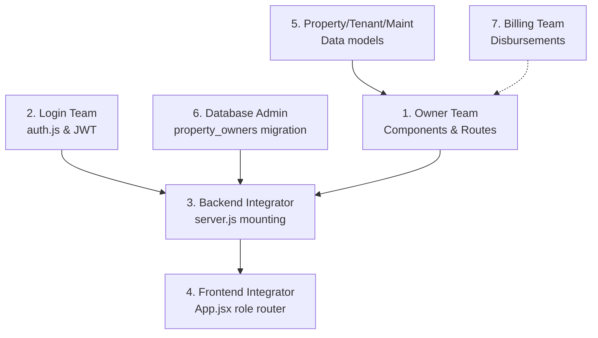

# PropertySE — Owner Module Cross-Team Responsibility Matrix

**Document Version:** 1.0.0-rc1  
**Date:** 2026-11-04  
**Author:** Senior Software Release Engineer & Full-Stack Architect  
**Project:** PropertySE (`feature-owner` -> `main`)  
**Scope:** Formal cross-team RACI matrix and integration contracts across 7 disciplines  
**Status:** **READY FOR TEAM EXECUTION**

---

## 1. Executive Summary

This matrix establishes clear operational boundaries, input prerequisites, deliverables, and acceptance criteria for all seven engineering disciplines participating in the PropertySE Owner Dashboard integration.

---

## 2. Seven-Team Responsibility Matrix

---

### Team 1: Owner Developer

| Dimension | Specification |
| :--- | :--- |
| **Primary Responsibility** | Maintain the 10 Owner Dashboard views, API service abstraction, payout masking, and trigger tests. Support integrators during merging. |
| **Required Inputs** | Feedback from QA, DBA migration sign-off, central Login token format. |
| **Files & Interfaces Involved**| - `client/src/components/owner/**` (13 files) - `client/src/services/ownerService.js` - `server/routes/ownerRoutes.js` - `server/test/owner-routes.test.js` - `server/test/owner-trigger.test.js` |
| **Dependencies** | Central Login module contract specification; DBA migration script. |
| **Expected Deliverable** | Stabilized, zero-defect release candidate package with 100% test passage. |
| **Acceptance Criteria** | 1. `npm.cmd run lint` passes with 0 errors and 0 warnings. 2. `npm.cmd run build` builds without errors in under 500ms. 3. All 15 owner-routes and 6 owner-trigger tests pass with 0 failures. 4. Sensitive bank coordinates are masked (`•••• 5544`) without logging raw values. 5. Production guard rejects preview mode in production builds. |

---

### Team 2: Login / Authentication Developer

| Dimension | Specification |
| :--- | :--- |
| **Primary Responsibility** | Implement central user authentication, JWT token issuance, verification middleware, and user login UI. |
| **Required Inputs** | Contract specification in `OWNER_LOGIN_INTEGRATION_CONTRACT.md`. |
| **Files & Interfaces Involved**| - `server/middleware/auth.js` (To be created) - `server/routes/authRoutes.js` (To be created) - `client/src/components/auth/LoginScreen.jsx` (or equivalent) - `public.users` table schema |
| **Dependencies** | User database migration; `JWT_SECRET` environment variable. |
| **Expected Deliverable** | `server/middleware/auth.js` exporting `authenticateUser` and `requireRole`; public `/api/auth` endpoints. |
| **Acceptance Criteria** | 1. `authenticateUser` parses `Authorization: Bearer <token>`, verifies signature/expiration, and rejects missing/invalid tokens with 401. 2. Populates `req.user` with `{ id, email, role, company_id, name }`. 3. Issues valid tokens containing `role: 'owner'` for test owner accounts. 4. Calls `ownerService.setAuthToken(token)` upon successful owner login. |

---

### Team 3: Backend Integration Developer

| Dimension | Specification |
| :--- | :--- |
| **Primary Responsibility** | Wire authentication middleware and mount Owner API routes into the central Express application pipeline. |
| **Required Inputs** | Merged `server/middleware/auth.js` from Login team; `server/routes/ownerRoutes.js` from Owner team. |
| **Files & Interfaces Involved**| - `server/server.js` - `server/routes/ownerRoutes.js` - `server/middleware/auth.js` |
| **Dependencies** | Completion of Login module; execution of database migration in staging. |
| **Expected Deliverable** | Updated `server/server.js` mounting `app.use("/api/owner", authenticateUser, ownerRoutes);`. |
| **Acceptance Criteria** | 1. `/api/owner/*` is strictly unreachable without a valid Bearer token (returns 401). 2. Requests with non-owner roles (tenant, worker) return 403 Forbidden. 3. Requests with valid owner tokens return 200 OK. 4. Unhandled server errors return formatted JSON without leaking stack traces. 5. Full backend test suite (`npm.cmd test`) reports 47+ passing tests. |

---

### Team 4: Frontend Integration Developer

| Dimension | Specification |
| :--- | :--- |
| **Primary Responsibility** | Implement application-level role routing and session token propagation in `client/src/App.jsx`. |
| **Required Inputs** | `OwnerDashboard.jsx`, `ownerService.js`, and Login UI components. |
| **Files & Interfaces Involved**| - `client/src/App.jsx` - `client/src/components/owner/OwnerDashboard.jsx` - `client/src/services/ownerService.js` |
| **Dependencies** | Login UI state management; authenticated user role context. |
| **Expected Deliverable** | Updated `client/src/App.jsx` conditionally mounting `<OwnerDashboard />` for owners and `<ManagerWorkspace />` for managers. |
| **Acceptance Criteria** | 1. Authenticating as an owner displays `OwnerDashboard` with all 10 views accessible. 2. Authenticating as a manager displays the existing Manager workspace. 3. On owner login, `ownerService.setDevelopmentPreview(false)` and `ownerService.setAuthToken(token)` are invoked. 4. On logout, `ownerService.clearAuthToken()` is invoked and memory token is cleared. 5. Zero CSS collisions between owner and manager styles. |

---

### Team 5: Property, Tenant & Maintenance Developers

| Dimension | Specification |
| :--- | :--- |
| **Primary Responsibility** | Preserve shared data schema compatibility across properties, embedded tenant fields, and maintenance work orders. |
| **Required Inputs** | Baseline schema in `202610270001_propertyse_tenants_maintenance.sql`. |
| **Files & Interfaces Involved**| - `server/routes/propertyRoutes.js` - `server/routes/maintenanceTicketRoutes.js` - `client/src/components/modules/ManagementModules.jsx` - `public.properties`, `public.maintenance_tickets` tables |
| **Dependencies** | Database connection pool (`server/config/db.js`). |
| **Expected Deliverable** | Backward-compatible property, tenant, and maintenance API endpoints. |
| **Acceptance Criteria** | 1. Modifying unit status or rent in `TenantManagement` immediately updates the owner's portfolio view. 2. Adding a maintenance ticket logs `property_id` and appears in the owner's maintenance list. 3. Property deletion safely cascades to associated `property_owners` records without leaving orphan rows. |

---

### Team 6: Database Administrator (DBA)

| Dimension | Specification |
| :--- | :--- |
| **Primary Responsibility** | Review, validate, and execute the ownership mapping and audit migration in staging and production Supabase databases. |
| **Required Inputs** | Migration draft `supabase/migrations/202611030001_create_property_owners.sql` and `OWNER_DATABASE_INTEGRATION_READINESS.md`. |
| **Files & Interfaces Involved**| - `supabase/migrations/202611030001_create_property_owners.sql` - Reversible rollback script in `OWNER_DATABASE_INTEGRATION_READINESS.md` - Supabase PostgreSQL instance |
| **Dependencies** | Confirmation of central user identity table (`public.users`). |
| **Expected Deliverable** | Successfully applied and indexed `public.property_owners` and `public.property_owners_audit` tables. |
| **Acceptance Criteria** | 1. Migration executes cleanly without lock timeouts or syntax errors. 2. Composite constraint `uq_properties_id_company UNIQUE (id, company_id)` is verified on `properties`. 3. Trigger `trg_validate_property_ownership` enforces cumulative percentage <= 100.00% using parent row locking. 4. Trigger `trg_log_property_ownership_audit` records append-only history. 5. Rollback script tested and verified in staging. |

---

### Team 7: Billing / Financial Developer

| Dimension | Specification |
| :--- | :--- |
| **Primary Responsibility** | Build automated rental disbursement execution, payment gateway integration, and payout settlement transaction tables. |
| **Required Inputs** | Masked bank coordinates from `property_owners.payout_account`. |
| **Files & Interfaces Involved**| - Future billing service (`server/routes/billingRoutes.js`) - Future payout ledger table (`public.owner_payout_transactions`) - `OwnerPayments.jsx` view |
| **Dependencies** | Banking provider API keys; payment processor webhooks. |
| **Expected Deliverable** | Automated disbursement engine populating real transaction records into the owner payment ledger. |
| **Acceptance Criteria** | 1. Executes bank transfers using sanitized coordinates without logging raw account numbers. 2. Emits completed wire transfer records queried by `GET /api/owner/financials/payments`. 3. Updates `OwnerPayments.jsx` from the current empty state to display real settlements. |

