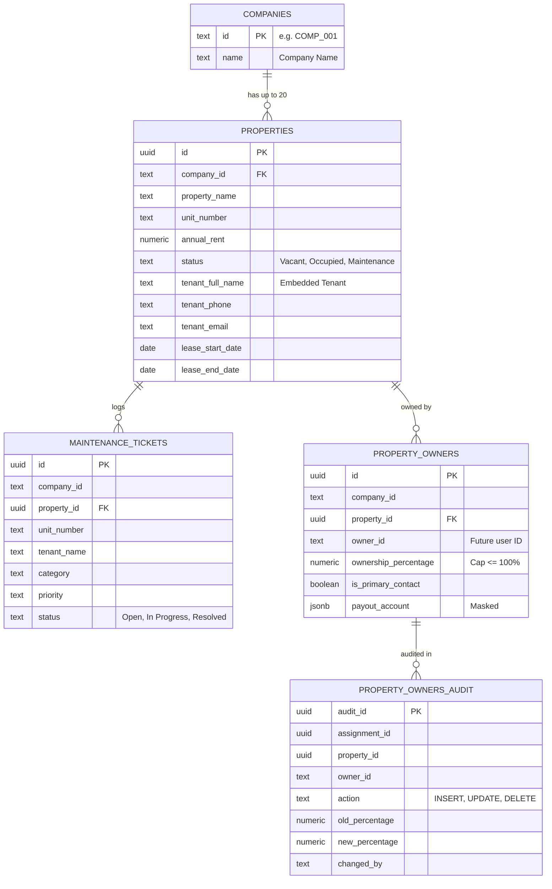

# PropertySE — Project-Wide Database & Dashboard Integration Audit

**Audit Date:** 2026-11-04  
**Auditor:** Senior Software Integration Architect, Database Auditor & Backend Security Reviewer  
**Repository:** `propertyse-v1`  
**Active Working Branch:** `feature-owner`  
**Git Base Commit:** `ecae518debb4f888546deafb3b4f5f5b4098e01d`  
**Audit Scope:** Project-Wide (Manager, Owner, Tenant, Worker, Login, Backend API, Database, Connectivity)  
**Execution Mode:** STRICT READ-ONLY AUDIT (Zero application code modified; Zero SQL executed)

---

## Executive Summary

PropertySE was conceived as a unified property operations platform serving four core stakeholders: **Property Managers**, **Property Owners**, **Tenants**, and **Maintenance Workers**.

This comprehensive audit investigated the actual state of all frontend components, backend Express routes, database schemas, and Supabase connectivity to establish a concrete, fact-based baseline for project-wide integration.

### High-Level Findings:
1. **Frontend Disparity:**
   - The **Manager Workspace** is fully implemented and active in `client/src/App.jsx`.
   - The **Owner Dashboard** is fully implemented across 10 views in `client/src/components/owner/`, supported by `ownerService.js` and an in-memory preview mode.
   - The **Tenant Dashboard**, **Worker Dashboard**, and **Login Module** are **completely missing** from the frontend codebase.
2. **Backend Security Boundary Defect:**
   - Existing live routes (`/api/properties`, `/api/maintenance-tickets`, `/api/companies`) have **zero authentication and zero authorization**. Anyone with network access can read, mutate, or delete property and ticket data.
   - The Owner routes (`server/routes/ownerRoutes.js`) implement strict JWT role guards (`requireOwnerAuth`, `requireManagementAuth`), but remain **unmounted** because central authentication middleware does not exist.
   - Independent Tenant and Worker API routes do not exist.
3. **Database Schema State:**
   - Only `public.properties`, `public.maintenance_tickets`, and `public.companies` exist in migrations.
   - The ownership mapping table `public.property_owners` is drafted in `202611030001_create_property_owners.sql` but unexecuted on Supabase.
   - `public.users`, `public.tenants`, `public.workers`, and `public.payments` are **completely missing** from database migrations.
4. **Database Connectivity Root Cause:**
   - The backend fails to connect to Supabase with PostgreSQL error `28P01` (`password authentication failed for user "postgres"`).
   - Network routing, DNS resolution, and TLS/SSL configuration (`rejectUnauthorized: false`) are **100% functional**. The connection successfully reaches the AWS Tokyo Supabase pooler (`aws-0-ap-northeast-1.pooler.supabase.com:5432`), but the database password configured in `server/.env` is rejected by PostgreSQL.

---

## 1. Frontend Dashboard Inventory

### 1.1 Property Manager Workspace
- **Main React Entry:** [`client/src/App.jsx`](file:///c:/Users/Asus/OneDrive/Desktop/works/Pentabytelabs/Propertyse-V1-main/Propertyse-V1-main/client/src/App.jsx)
- **Views & Components:**
  - `PortfolioSnapshot.jsx`: Portfolio KPI cards (Total Units, Occupancy %, Gross Annual Rent, Available Units).
  - `UnitTable.jsx`: Property listing table with unit details, rental amounts, vacancy status, and action buttons (`Edit rent`, `View details`, `Assign tenant`).
  - `unitmodel.jsx`: Add Unit modal dialog (`propertyName`, `buildingNumber`, `unitNumber`, `annualRent`, `status`, `estimatedRepairCost`, `tenantReady`).
  - `components/layouts/sidebar.jsx`: Left navigation sidebar with company selector (`COMP_001`, `COMP_002`) and navigation links.
  - `components/layouts/topbar.jsx`: Top navigation header with user avatar (`PM` - Property Manager).
  - `components/modules/ManagementModules.jsx`:
    - `TenantManagement`: Manager tenant directory, lease date editor modal, and annual rent editor modal.
    - `MaintenanceManagement`: Raise maintenance ticket form and ticket status tracking table (`Open`, `In Progress`, `Resolved`).
    - `CompanyManagement`: Company directory with create form (`id`, `name`) and remove company action.
- **API Service File:** No centralized service file. Direct `fetch()` calls are embedded inside `App.jsx` and `ManagementModules.jsx`.
- **API Endpoints Called:**
  - `GET /api/companies`, `POST /api/companies`, `DELETE /api/companies/:id`
  - `GET /api/properties?companyId=...`, `POST /api/properties`
  - `PATCH /api/properties/:id/status`, `PATCH /api/properties/:id/rent?companyId=...`, `PATCH /api/properties/:id/tenant?companyId=...`
  - `GET /api/maintenance-tickets?companyId=...`, `POST /api/maintenance-tickets`, `PATCH /api/maintenance-tickets/:id/status`
- **Hardcoded / Mock Data:** `DEFAULT_COMPANIES = [{ id: 'COMP_001', name: 'Sunrise Property Group' }, { id: 'COMP_002', name: 'BlueSky Estates' }]` fallback if API fails.
- **Loading / Error / Empty States:** Spinners, error alert banners, and empty table rows ("No properties registered", "No maintenance tickets match this view").
- **Navigation & Role Access:** Internal `activeSection` state. Role is hardcoded as Property Manager. No authentication or login gate exists.

---

### 1.2 Property Owner Dashboard
- **Main React Entry:** [`client/src/components/owner/OwnerDashboard.jsx`](file:///c:/Users/Asus/OneDrive/Desktop/works/Pentabytelabs/Propertyse-V1-main/Propertyse-V1-main/client/src/components/owner/OwnerDashboard.jsx)
- **Views & Components:**
  - `OwnerSidebar.jsx` & `OwnerTopbar.jsx`: Scoped navigation and breadcrumbs.
  - 10 Subviews: `OwnerOverview`, `OwnerProperties`, `OwnerPropertyDetails`, `OwnerTenants`, `OwnerRentalIncome`, `OwnerPayments`, `OwnerMaintenance`, `OwnerReports`, `OwnerNotifications`, `OwnerSettings`.
- **API Service File:** Centralized in [`client/src/services/ownerService.js`](file:///c:/Users/Asus/OneDrive/Desktop/works/Pentabytelabs/Propertyse-V1-main/Propertyse-V1-main/client/src/services/ownerService.js).
- **API Endpoints Called:** `/api/owner/overview`, `/api/owner/properties`, `/api/owner/properties/:id`, `/api/owner/tenants`, `/api/owner/financials/income`, `/api/owner/financials/payments`, `/api/owner/maintenance`, `/api/owner/reports`, `/api/owner/notifications`, `/api/owner/settings`.
- **Hardcoded / Mock Data:** `DEV_PREVIEW_DATA` in `ownerService.js` provides comprehensive mock data for offline development. Preview mode is physically rejected in production builds (`import.meta.env?.PROD`).
- **Loading / Error / Empty States:** Loading skeletons, error alerts with retry callbacks, honest empty states (`0 Transactions` for payouts, "No tenants found").
- **Navigation & Role Access:** Internal tab navigation. In production, requires `role: "owner"`. Currently accessible in dev mode via development switcher banner.

---

### 1.3 Tenant Dashboard
- **Status:** **NOT IMPLEMENTED AS A STANDALONE DASHBOARD**.
- **Existing Traces:**
  - In `client/src/App.jsx`, the `'tenants'` tab renders `TenantManagement` from `ManagementModules.jsx`, which is exclusively an **administrative manager tool** for editing leases and rent.
  - There is no tenant self-service portal, no tenant login screen, no ability for a tenant to view their own lease, make payments, or track work orders.
  - Tenant data is embedded directly as text columns on `public.properties` (`tenant_full_name`, `tenant_phone`, `tenant_email`, `lease_start_date`, `lease_end_date`).
- **Missing Work:** Complete frontend tenant portal implementation.

---

### 1.4 Worker Dashboard
- **Status:** **NOT IMPLEMENTED**.
- **Existing Traces:**
  - No worker components, views, or routing exist in `client/src/`.
  - In `maintenanceTicketRoutes.js`, maintenance tickets track `category`, `description`, `priority`, and `status`, but contain no field or foreign key for an assigned technician.
- **Missing Work:** Complete frontend worker portal implementation.

---

### 1.5 Login / Authentication Module
- **Status:** **NOT IMPLEMENTED**.
- **Existing Traces:**
  - No login screen, registration form, password reset, or JWT session management exists in `client/src/`.
  - The application opens directly into `App.jsx` assuming a Property Manager session.
  - An authentication contract has been formally specified in `OWNER_LOGIN_INTEGRATION_CONTRACT.md`, but neither UI nor backend middleware exists.
- **Missing Work:** Complete frontend login UI, auth context provider, and token storage.

---

## 2. Backend API Inventory & Security Analysis

All server logic is concentrated in [`server/server.js`](file:///c:/Users/Asus/OneDrive/Desktop/works/Pentabytelabs/Propertyse-V1-main/Propertyse-V1-main/server/server.js) and four route files in `server/routes/`. Directories `server/middleware/` and `server/controllers/` do not exist.

### 2.1 Backend Route Map

| Route File | Mount Path | Mounted in `server.js`? | Endpoints Count | Auth Guard | Role / Tenant Authorization |
| :--- | :--- | :--- | :--- | :--- | :--- |
| `propertyRoutes.js` | `/api/properties` | **YES** | 6 endpoints | **NONE** | Unverified `companyId` query param only |
| `maintenanceTicketRoutes.js` | `/api/maintenance-tickets` | **YES** | 3 endpoints | **NONE** | Unverified `companyId` query param only |
| `companyRoutes.js` | `/api/companies` | **YES** | 3 endpoints | **NONE** | **NONE** (Open public mutation) |
| `ownerRoutes.js` | `/api/owner` | **NO (Unmounted)** | 11 endpoints | `requireOwnerAuth`, `requireManagementAuth` | Strict `req.user.id` and `req.user.role` |
| Health Handlers | `/api/health`, `/api/db-diagnostics` | **YES** | 2 endpoints | **NONE** | Public diagnostics (credentials sanitized) |

### 2.2 Critical Backend Security Defects
1. **Unauthenticated Public Mutations:**
   - Any external user can execute `POST /api/properties` to create units, `PATCH /api/properties/:id/rent` to alter rent, or `PATCH /api/properties/:id/tenant` to overwrite or wipe tenant assignments.
   - Any external user can execute `DELETE /api/companies/:id` to delete company records.
2. **Missing Upstream Auth Middleware:**
   - `ownerRoutes.js` expects `req.user` to be populated by an upstream `authenticateUser` middleware. Because no such middleware exists in `server.js`, mounting `ownerRoutes` today would cause every request to fail with `401 Unauthorized` or crash.
3. **Inconsistent API Response Contracts:**
   - `propertyRoutes.js` dual-emits both `id` and `_id`, and mixes camelCase with snake_case.
   - `maintenanceTicketRoutes.js` wraps results in `{ tickets: [...] }`.
   - `companyRoutes.js` returns bare arrays `[...]`.
   - `ownerRoutes.js` returns strictly formatted camelCase domain models.

---

## 3. Database Schema Inventory

The database is defined across two migration files in `supabase/migrations/`:
1. `202610270001_propertyse_tenants_maintenance.sql` (Baseline migrations)
2. `202611030001_create_property_owners.sql` (Owner module migration draft)

### 3.1 Existing Tables Summary



### 3.2 Missing Database Entities
1. **`public.users`:** No user table exists. User credentials, password hashes, roles, and profiles are completely missing.
2. **`public.tenants`:** Standalone tenant entity does not exist. Tenant data is flattened onto `public.properties`.
3. **`public.workers`:** No technician roster, worker assignments, or work order tracking exists.
4. **`public.payments`:** No payment ledger, rent collections, or payout settlement records exist.

---

## 4. Database Connectivity Diagnostics

The local backend currently reports:
`checkHealth errorCategory: AUTHENTICATION`  
`checkHealth errorSummary: Database authentication failed`  
`rawError: password authentication failed for user "postgres"`

### 4.1 Redacted Configuration Audit
- **Connection URL:** Fully configured via `DATABASE_URL` in `server/.env`.
- **Target Host:** `aws-0-ap-northeast-1.pooler.supabase.com` (Tokyo region Supabase Session Pooler).
- **Target Port:** `5432` (Session Pooler port).
- **Database Name:** `postgres`.
- **Username Format:** `postgres.oyjmdtngezoqvgkqfhay` (correctly formatted with `postgres.[PROJECT_REF]` matching `SUPABASE_URL: https://oyjmdtngezoqvgkqfhay.supabase.co`).
- **SSL / TLS Configuration:** `requiresSsl: true`, `ssl: { rejectUnauthorized: false }`. Handshake succeeds cleanly over TLS 1.3 / AES-GCM.

### 4.2 Root Cause Analysis
- **PostgreSQL Error Code:** `28P01` (`password authentication failed for user "postgres"`).
- **Explanation:** Network routing, DNS resolution, and TLS encryption are operating correctly. The connection reaches the Supabase Session Pooler, and the pooler routes to project `oyjmdtngezoqvgkqfhay`. However, the password supplied in `DATABASE_URL` is rejected by PostgreSQL.
- **Circuit Breaker:** Repeated failed connection attempts have triggered Supabase pooler's rate-limiting circuit breaker (`ECIRCUITBREAKER`).
- **Remediation:** The database administrator must reset or retrieve the database password in the Supabase Dashboard under `Project Settings > Database > Database password`, and update `DATABASE_URL` in `server/.env` (ensuring special characters are URL-encoded).

---

## 5. Cross-Dashboard Integration Matrix

| Module | Frontend Status | Backend API Status | Database Status | Authentication Status | Missing Work | Responsible Team |
| :--- | :--- | :--- | :--- | :--- | :--- | :--- |
| **Login / Auth** | **Missing** | **Missing** | **Missing** (`users` table absent) | **Missing** (No JWT signer or validator) | 1. `public.users` migration<br/>2. `/api/auth/login` endpoint<br/>3. `server/middleware/auth.js`<br/>4. React Login view | Login / Auth Team |
| **Manager Dashboard** | **Implemented** (`App.jsx`, `UnitTable`, `ManagementModules`) | **Live but Insecure** (`propertyRoutes`, `maintenanceTicketRoutes`, `companyRoutes`) | **Partially Implemented** (`properties`, `maintenance_tickets`, `companies`) | **Missing** (Open unauthenticated endpoints) | 1. Secure routes with `authenticateUser` + `requireRole(['manager', 'admin'])`<br/>2. Resolve DB password | Manager / Backend Team |
| **Owner Dashboard** | **Implemented** (10 views, `ownerService.js`, preview mode) | **Implemented but Unmounted** (`ownerRoutes.js` with role guards) | **Drafted but Unexecuted** (`202611030001_create_property_owners.sql`) | **Contract Defined; Gated** (`requireOwnerAuth` ready; awaiting JWT) | 1. DBA review and apply migration in staging<br/>2. Mount `/api/owner` in `server.js`<br/>3. Wire live token | Owner Team & DBA |
| **Tenant Dashboard** | **Missing** (Manager tenant edit view only) | **Missing** (No `/api/tenants` routes) | **Missing / Embedded** (Embedded on `properties`) | **Missing** | 1. Determine tenant data model (embedded vs table)<br/>2. Build `/api/tenants`<br/>3. Build Tenant portal UI | Tenant Team |
| **Worker Dashboard** | **Missing** | **Missing** | **Missing** (`workers` table absent) | **Missing** | 1. Create `public.workers` table<br/>2. Add worker assignment to tickets<br/>3. Build Worker portal UI | Worker Team |

---

## 6. Target Integration Architecture & Data Flows

```mermaid
graph TD
    Client[React 19 Frontend - Vite] --> Router{Role Router}
    
    Router -- role: manager --> ManagerUI[Manager Workspace]
    Router -- role: owner --> OwnerUI[Owner Dashboard]
    Router -- role: tenant --> TenantUI[Future Tenant Portal]
    Router -- role: worker --> WorkerUI[Future Worker Portal]
    
    ManagerUI -->|Bearer JWT| Express[Express 5 Server]
    OwnerUI -->|Bearer JWT| Express
    TenantUI -->|Bearer JWT| Express
    WorkerUI -->|Bearer JWT| Express
    
    Express --> AuthMW[server/middleware/auth.js<br/>authenticateUser]
    AuthMW --> RoleMW[requireRole]
    
    RoleMW --> PropertyAPI[/api/properties]
    RoleMW --> MaintenanceAPI[/api/maintenance-tickets]
    RoleMW --> CompanyAPI[/api/companies]
    RoleMW --> OwnerAPI[/api/owner]
    
    PropertyAPI --> DB[(Supabase PostgreSQL)]
    MaintenanceAPI --> DB
    CompanyAPI --> DB
    OwnerAPI --> DB
```

### Shared Integration Standards:
1. **Centralized User Model (`public.users`):** All four dashboards must anchor their user identity to a single `users` table (`id`, `email`, `password_hash`, `role`, `company_id`, `name`).
2. **Unified Authentication Middleware (`server/middleware/auth.js`):** Every API request must pass through `authenticateUser` to verify the JWT and populate `req.user`.
3. **Multi-Tenant Company Isolation:** Every SQL query must include `company_id = req.user.company_id` (except platform superadmins).
4. **Owner-Specific Scoping:** All owner queries must join `property_owners po` and filter by `po.owner_id = req.user.id`.
5. **Data Egress Sanitization:** Sensitive banking coordinates must pass through `maskPayoutAccount` before transmission over the network.

---

## 7. Deliverables Reference Guide

The following detailed audit reports have been compiled in the project root:

1. [`PROPERTYSE_PROJECT_WIDE_INTEGRATION_AUDIT.md`](file:///c:/Users/Asus/OneDrive/Desktop/works/Pentabytelabs/Propertyse-V1-main/Propertyse-V1-main/PROPERTYSE_PROJECT_WIDE_INTEGRATION_AUDIT.md): This master audit document.
2. [`PROPERTYSE_DATABASE_SCHEMA_INVENTORY.md`](file:///c:/Users/Asus/OneDrive/Desktop/works/Pentabytelabs/Propertyse-V1-main/Propertyse-V1-main/PROPERTYSE_DATABASE_SCHEMA_INVENTORY.md): Comprehensive inventory of database tables, columns, constraints, foreign keys, triggers, and missing entities.
3. [`PROPERTYSE_API_ENDPOINT_MATRIX.md`](file:///c:/Users/Asus/OneDrive/Desktop/works/Pentabytelabs/Propertyse-V1-main/Propertyse-V1-main/PROPERTYSE_API_ENDPOINT_MATRIX.md): Complete matrix of all 22 backend endpoints, parameters, authentication status, and contract inconsistencies.
4. [`PROPERTYSE_CROSS_DASHBOARD_INTEGRATION_PLAN.md`](file:///c:/Users/Asus/OneDrive/Desktop/works/Pentabytelabs/Propertyse-V1-main/Propertyse-V1-main/PROPERTYSE_CROSS_DASHBOARD_INTEGRATION_PLAN.md): Technical integration blueprint, shared entity contracts, role-based routing, and prioritized action plan.
5. [`PROPERTYSE_DATABASE_CONNECTION_DIAGNOSTIC.md`](file:///c:/Users/Asus/OneDrive/Desktop/works/Pentabytelabs/Propertyse-V1-main/Propertyse-V1-main/PROPERTYSE_DATABASE_CONNECTION_DIAGNOSTIC.md): Forensic analysis of `server/config/db.js`, connection pool settings, SSL verification, and the password authentication error `28P01`.

